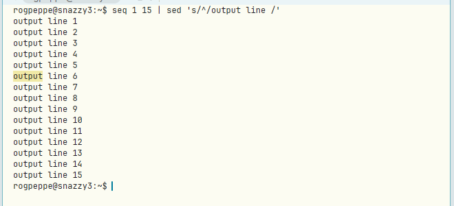
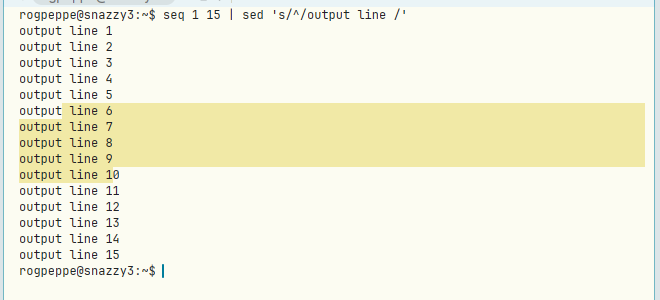
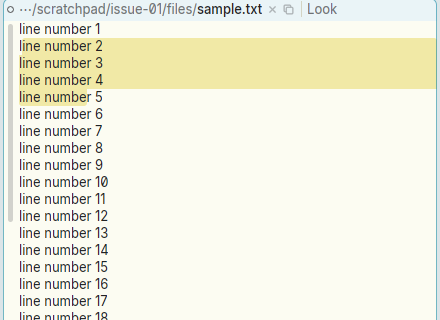

# Terminal: B1 sweep is ignored when it starts soon after a click

**Type:** bug
**Area:** terminal, mouse

## Summary

In a terminal window, if you click B1 and then quickly press B1 again and drag
(a "click, then drag"), no sweep happens. The second press counts as a
double-click, so it selects the word or line under the pointer, and the drag
that follows does nothing. A plain press-and-drag works, and so does a press
that comes more than the double-click interval after the previous click. In an
ordinary text window the same click-then-drag sweeps as expected.

## Steps to reproduce

1. Start Apex and run `Newterm`.
2. In the terminal, run `seq 1 15 | sed 's/^/output line /'`.
3. Click B1 on the word `output` of `output line 6`.
4. Straight away (well inside the double-click interval), press B1 again in
   the same place and, keeping it down, drag down to `output line 10`. Then
   release.
5. For comparison, open a text file and do the same thing (click, then press
   quickly and drag) in its body.

## Expected behaviour

The drag sweeps a selection from the press point to the release point, as it
does in a text window. Acme behaves this way: in `textselect`, after a
double-click selection it waits only while the mouse stays within a few
pixels. Once the pointer moves with the button still down, it falls through
to `frselect` and sweeps from the press point, replacing the word or line
selection. Apex's text windows already do this (they set up the B1 drag
after a double-click too).

## Actual behaviour

Only the double-click selection is made: the word `output` on line 6 (or the
whole line, if the press was at the start of the line). Dragging while the
button is down does not change the selection, and on release the selection is
still just that word or line. If you wait about a second between the click and
the press-and-drag, the sweep works. Nothing is sent to the shell.

## Screenshots

Terminal, quick click then press-and-drag from line 6 to line 10: only the
double-clicked word `output` is selected.

Terminal, the same drag with a one-second pause after the click: it sweeps.

Text window, quick click then press-and-drag from line 2 to line 5: it sweeps.

## Notes

- Reproduced on Linux under X11 (nested Xephyr), using the prebuilt binaries
  from branch `001-linux-support` (afce379), driven with xdotool. It happens
  every time.
- Likely code: `crates/apex-client/src/app.rs` around lines 3563-3579, in the
  `(Target::Term(w, t), ..)` B1 arm of the mouse-down handler. When
  `e.click_count >= 2`, it sets `term_sel` to the `term_double_click` range
  but does not set `self.mouse.term_drag`, so later mouse moves are ignored.
  The text-view arm just above it (around line 3531) sets `self.mouse.b1`
  in both cases, which is why text windows sweep. To match acme, a drag that
  moves past a small threshold after the double-click should start a sweep
  from the press point.

## Fix

`crates/apex-client/src/app.rs`: the terminal's B1 press now sets
`mouse.term_drag` on a double-click too, and records the pressed cell in a new
`mouse.term_dbl`. In `mouse_move`, while the pointer stays in that cell the
word/line selection stands; once it leaves, the selection becomes a sweep
anchored at the press point (and `term_dbl` is cleared), as in acme's
`textselect`. The fix is in the commit containing this section.
