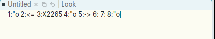

# Support acme's Alt compose sequences for typing Unicode

**Type:** feature request; **Area:** keyboard input / typing

## Summary

Apex has no way to type a character that is not on the keyboard. Plan 9 and
plan9port acme do: tap Alt, then type a short sequence (`"o` → ö, `<=` → ≤,
`->` → →, `*a` → α) or `X` and hex digits (`X2265` → ≥). Apex should support
the same sequences, built from the same table.

## Current behaviour

There is no compose or latin1 code anywhere in the client (a grep for
`compose`, `latin1` and `Multi_key` under `crates/` finds nothing relevant).
In a text view, `key_down`/`text_key` ignore Alt for ordinary keys and insert
`ks.key_char` as it stands, so an Alt sequence types its characters literally.

Tried in a nested Xephyr with xdotool, in a fresh `Untitled` window (Ctrl+N):

1. Tap `Alt_L`, then type `"o`. Got `"o`.
2. Tap `Alt_L`, then type `<=`. Got `<=`.
3. Tap `Alt_L`, then type `X2265`. Got `X2265`.
4. Hold Alt while typing `"` and `o` (`alt+quotedbl alt+o`). Got `"o`.
5. Hold Alt while typing `-` and `>`. Got `->`.
6. `Multi_key " o` (the X compose key). Got `"o`, but the nested X server has
   no input method running, so this says nothing about a real desktop.

(The keysym `eacute`, sent by xdotool through a temporarily remapped keycode,
inserted nothing. That is probably an xdotool/Xephyr artifact and not part of
this request.)

Right now the only ways to get such characters on Linux are an IME (if gpui's
X11 backend passes its output through) or pasting. On macOS the system Option
layer gives some accented letters, but not acme's table, and Option already
means other things in Apex (see below).

## Proposed behaviour

Do what plan9port does (devdraw's `latin1.c`, driven by `lib/keyboard`):

- **Trigger.** Pressing and releasing Alt by itself (acme's `Kalt`, with no
  other key or button in between) starts a compose sequence. The keys that
  follow build up the sequence and are not inserted.
- **Table.** Two-character (and a few longer) sequences from plan9port's
  `lib/keyboard`. Each line gives the code point, the sequence and the
  character, e.g. `00F6  "o  ö`, `2264  <=  ≤`, `2192  ->  →`, `03B1  *a  α`.
  plan9port generates its `latin1.h` from this file with `mklatinkbd`. Apex
  could include a generated Rust table, or parse the file at build time,
  vendoring `lib/keyboard` (plan9port's licence is MIT-style). The code
  matches prefixes: it waits while the typed keys are still the prefix of
  some entry, and finishes on an exact match.
- **Hex.** `X` followed by up to four hex digits gives that code point
  (`Alt X 2 2 6 5` → ≥). A non-hex key ends the sequence early. A `x`/longer
  form for code points above U+FFFF would be a reasonable extension (check
  the current plan9port source for whether it already has one).
- **No match.** As in acme, a sequence that cannot match anything is
  dropped, or its keys are inserted literally. Pick one and document it.
  Escape cancels.
- **Where.** In text views (body and tag) and the line-edit fields
  (finder, tag path picker and the others). In a terminal, Alt+key must stay
  Meta (`ESC` + key, per `encode_key`). But a *tap* of Alt followed by a
  sequence could still send the composed character to the program as UTF-8,
  as typing into a win window does in acme.
- **Feedback.** acme shows nothing while a sequence is pending. Apex could
  show the keys typed so far at the caret, faint, but this is optional.

Conflicts to watch for: Alt is also Apex's laptop chord key (Alt pressed while
B1 is held cuts; ⌥-click is B2; holding ⌥ over text shows the B2 hint). That
fits the "tap alone" rule. plan9port on the Mac has the same design: option
plus a click is button 2, and option tapped alone is compose. Only a press
and release with nothing else in between should start a sequence. The
Ctrl+Alt+N shortcut is not affected.

## Rationale

Apex is modelled on acme, and acme users type `Alt "o`, `Alt <=`, `Alt *l`
and so on without thinking about it. The table is also a portable,
editor-independent way to type maths symbols, Greek, arrows and accented
letters on any OS, with no system input method configured. It does not clash
with existing bindings as long as only a lone Alt tap triggers it.

## Screenshots

What the sequences above typed (lines 1–8 run together on one line).
Every sequence came out literally:

## Notes

- Environment: Linux, X11 (Xephyr nested display), prebuilt
  `target/apex-linux/bin/apex-ui` from branch `001-linux-support`. Current
  behaviour reproduced as described.
- Likely place for the change: `Acme::key_down`, around
  `crates/apex-client/src/app.rs:4996`, which routes keys to the
  finder/fields, the terminal (`term_key`, ~5110) and `text_key` (~5330).
  The literal insertion is the `_ => match &ks.key_char` arm at
  `crates/apex-client/src/app.rs:5505`. Detecting a lone Alt tap means
  tracking Alt in `modifiers_changed` (`crates/apex-client/src/app.rs:3958`),
  which already watches Alt for chording.
- References: plan9port `lib/keyboard`, `src/cmd/devdraw/latin1.c`
  (`mklatinkbd` makes `latin1.h`); Plan 9 `/lib/keyboard`,
  `/sys/src/9/port/latin1.c`; keyboard(6).

## Fix

Implemented as plan9port does it. Pressing and releasing Alt alone, with
no key, button or other modifier in between, starts a compose sequence
(`Acme::alt_tapped`, called from `modifiers_changed`). A second tap or a
click cancels it. While it is pending, `key_down` collects printable keys
and asks `compose::step` (new `crates/apex-client/src/compose.rs`) what
they make. `compose.rs` reads plan9port's `lib/keyboard` (vendored with
its MIT LICENSE in `crates/apex-client/assets/keyboard/`) the way
`mklatinkbd` does, and matches as devdraw's `latin1` does: `X`, `XX` or
`XXX` take 4, 5 or 6 hex digits. The character goes on as one typed key
through the new `key_typed`, so it reaches bodies, tags, every field and
terminals (as UTF-8 to the program). A key that matches nothing types
the collected keys literally, as devdraw does. Escape drops the sequence.
Alt+key stays Meta in terminals, and the ⌥ chords and ⌥-click are
unchanged. The feature is enabled on macOS too, as plan9port's Mac
devdraw has it. The commit is the one that contains this section.
