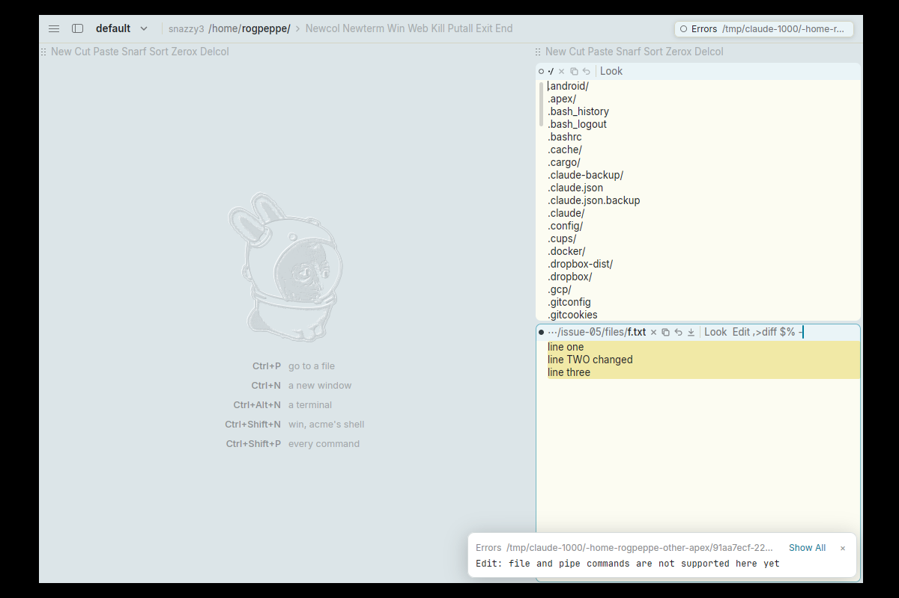

# Edit's pipe and file commands (`>`, `|`, `<`, `w`, `r`, `e`, `f`, ...) are not implemented, so `Edit ,>diff $% -` fails

**Type:** feature request (missing acme behaviour)
**Area:** Edit language

## Summary

In acme, `Edit ,>diff $% -` is the usual way to see a window's unsaved
changes: it sends the whole body to `diff <file> -`, with `$%` naming the
window's file. In Apex the command is parsed but never run. Instead it
reports `Edit: file and pipe commands are not supported here yet`. The
problem is not `$%`: shell commands get `$%` and `$samfile`, and the bundled
rc expands them correctly. Every Edit command that needs a file or a shell
command fails the same way: `>`, `|`, `<`, `w`, `r`, `e` and `f`.
docs/userguide.html already lists this as a known limitation.

## Current behaviour

1. Open a file, e.g. `apex open f.txt`, where f.txt contains
   `line one / line two / line three`.
2. Change the body without running Put, e.g. change line 2 to `line TWO changed`.
   The window is now marked dirty.
3. Type `Edit ,>diff $% -` in the window's tag and middle-drag across it to run it.
   (`apex exec WIN 'Edit ,>diff $% -'` or `apex edit WIN ',>diff $% -'` give
   the same result.)

Result: no diff appears. The `+Errors` window and its notification show:

```
Edit: file and pipe commands are not supported here yet
```

The CLI exits with status 1 and prints the same message. Each of these also
gives exactly the same error: `,|sort`, `,<date`, `w`, `r /etc/hostname`,
`e`, `f` and `,>wc -l`.

## Proposed behaviour

Do what acme's Edit does (sam's commands):

- `>cmd` sends the addressed text to `cmd`'s stdin and puts its output in
  `+Errors`. Here that means `+Errors` would show
  ```
  2c2
  < line two
  ---
  > line TWO changed
  ```
- `|cmd` replaces the addressed text with `cmd`'s output, given that text as input.
- `<cmd` replaces the addressed text with `cmd`'s output.
- `w`, `r`, `e`, `f`, `b`, `B` and `D` do the file and window operations
  they do in acme.
- These commands run with the same environment as B2 shell commands: `$%`,
  `$samfile` and `$winid`, in the window's directory.

## Rationale

`Edit ,>diff $% -` (and `Edit ,|fmt`, `Edit ,x/.../ | cmd`, and so on) is an
everyday acme idiom. It is one of the main reasons Edit exists alongside
plain B2 commands.

Workaround for now: select the whole body (`Edit ,` sets dot to it), then
run `>diff $% -` as a plain B2 command. That path works and shows the diff
in `+Errors`, followed by `diff: exit 1`.

## Screenshots

Running `Edit ,>diff $% -` from the tag of a modified window:



## Notes

- Reproduced on Linux under nested Xephyr/X11, using the prebuilt binaries
  from branch 001-linux-support (apex-ui, apex, bundled rc).
- The environment is already correct. `crates/apex-server/src/lib.rs:2245`
  (`command_env`) sets `%` and `samfile`, and the bundled rc expands `$%`.
  Run outside Apex, `echo hi | env '%=file' rc -c 'diff $% -'` works.
- `crates/apex-edit/src/exec.rs:319-331` parses these commands into
  `Intent::Pipe`, `Intent::Write`, and so on. `Node::run_edit`
  (`crates/apex-core/src/node.rs:~1807`) only carries out `Intent::Undo`.
  The `Edit` builtin (`crates/apex-core/src/node.rs:2217`) returns the error
  above for any other intent that is left. Nothing else in the tree handles
  `Intent::Pipe` or `PipeKind`.
- If a program mixes text edits with an unsupported command, the text edits
  are applied first and the error comes after. So the program partly runs
  and then reports failure.
- Known limitation, documented in docs/userguide.html (around line 222):
  "The file and pipe commands (e, w, |, and so on) are not supported yet".

## Fix

An `Edit` program with file or shell commands (`< | > e r w f b B D`) is
now the server's: `Node::resolve` sends it there (`Node::edit_is_servers`)
instead of running it on the leader, so a program that can't run is never
partly applied. The server runs the whole program on a thread of its own.
apex-edit gained a `Host` trait (`run`, `read`, `write`, `path`), which it
calls synchronously as the program reaches each command, as acme's
`runpipe`/`loadfile`/`putfile`. The server's `EditHost` runs commands as
B2 does: rc, `$%`/`$samfile`/`$winid`, in the window's directory, listed
as the session's processes. The program's changes come back as
`Proposal::EditDone`, which the leader applies as one undo step only if
the body is still at the version the program ran over.
`|`, `<`, `>`, `w`, `r`, `e`, `f`, `B` and `D` are implemented (`B`/`D`
take `<cmd` lists too). Not done: `b` (a program edits one window's text;
it fails with "b command is not supported"). `u` is refused in a program
with file or shell commands, before anything runs. `!` is not an acme Edit
command. The fix is in the commit that contains this file.
