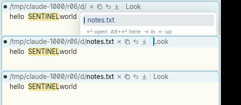
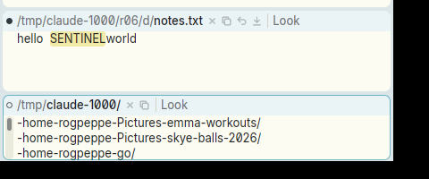
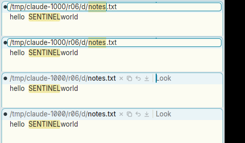

# Paste chord (B1-B3) on the window's name in the tag does nothing

**Type:** bug
**Area:** tag, mouse (chords)

## Summary

In acme the window's name is ordinary text at the start of the tag. You
can sweep part or all of it with B1 and click B3 (the paste chord), and
the swept text is replaced by the snarf buffer. This is the quick way to
rename a window: snarf a new name somewhere, then chord it over the old
one. In Apex the path is drawn as a separate breadcrumb "head" in front
of the editable tag text. A B1 press on it never starts a sweep, so the
B3 that follows is not a chord. Nothing is pasted, and the window keeps
its name. Depending on where the press lands, B3 is instead handled as a
plain B3 on the head: on a folder, it plumbs the folder and opens a new
directory window.

## Steps to reproduce

1. Start Apex. Open a file with a short path:
   `mkdir -p /tmp/r/d && echo 'hello SENTINEL world' > /tmp/r/d/notes.txt && apex open /tmp/r/d/notes.txt`.
   The tag reads `○ /tmp/r/d/notes.txt × ⧉ | Look`.
2. As a control, and to load the snarf buffer: in the body, sweep
   `SENTINEL` with B1 and, still holding B1, click B2 (cut). Then B1-click
   where it was and click B3 (paste). `SENTINEL` comes back, so chords
   work, and the snarf buffer holds `SENTINEL`.
3. **Sweep then paste.** In the tag, press B1 on `notes.txt`, drag across
   it, and while still holding B1, click B3. Release B1.
4. **Click then paste.** Press B1 on `notes.txt` without moving (a null
   selection), click B3, and release B1.
5. **On a folder.** Press B1 on a folder of the path (e.g. `r`), click B3,
   and release B1.
6. **In the rename field.** Double-click `notes.txt` to open the rename
   field. Then sweep in the field with B1 and click B3.

## Expected behaviour

As in acme, where chords work the same in every text, the tag's name
included:

- Step 3 replaces the swept `notes.txt` with `SENTINEL`. The tag now reads
  `/tmp/r/d/SENTINEL`, and the window's name changes with it (as typing a
  new name would; see 02 for when Apex commits a rename).
- Step 4 inserts `SENTINEL` at the click, giving e.g.
  `/tmp/r/d/notSENTINELes.txt`.
- Step 5 replaces or inserts at the folder in the same way. It does not
  open anything.
- Step 6: at the very least, inside the rename field, where the path is
  shown as editable text, the paste chord should paste.

If Apex keeps the breadcrumb, the chord could still be mapped onto it:
for example, the press starts a sweep over the path's characters instead
of opening the picker at once, and B3 pastes over that sweep as a rename.

## Actual behaviour

- **Step 3:** the B1 press opens the breadcrumb picker at once. The name
  is taken out of the tag and a query caret is put after `/tmp/r/d/`. The
  drag selects nothing. B3 closes the picker, and the tag's caret moves to
  before `Look`. Nothing is pasted: the name is still `notes.txt`, the tag
  text is still `Look`, the body is unchanged, and `apex win` shows the
  same path.
- **Step 4:** the same as step 3.
- **Step 5:** the picker opens, and B3 closes it and plumbs the folder, as
  a plain B3 would. A new directory window opens for a folder of the path.
  In my run, pressing on `r06` of `/tmp/claude-1000/r06/d/notes.txt`
  opened `/tmp/claude-1000/`.
- **Step 6:** the B1 drag doesn't change the field's selection. B3
  dismisses the field without renaming, and the caret moves to before
  `Look`.

B2 can't set up a paste on the head either: B2 there does nothing at all
(issue 07).

## Screenshots

Steps 3/4. Top: B1 held on the name. The picker is open and the name is
gone from the tag. Middle: after B3, the picker is closed and the caret
is before `Look`. Bottom: after B1 is released, the name is unchanged and
nothing was pasted (the body's `SENTINEL` is from the control):

Step 5. The chord on a folder plumbs it instead, and a new
`/tmp/claude-1000/` window opens below:

Step 6. The rename field, with `notes` selected. A B1 drag inside it
changes nothing, then B3 closes it with nothing pasted:

## Notes

- Reproduced on Linux/X11 in a nested Xephyr, with prebuilt
  `target/apex-linux/bin/apex-ui` from branch `001-linux-support` and a
  private daemon. The mouse was driven by xdotool. A B1-B2 and a B1-B3
  chord in the body worked as a control beforehand. The test file was
  `/tmp/claude-1000/r06/d/notes.txt`.
- Code pointer: in `Acme::mouse_down`
  (`crates/apex-client/src/app.rs`, around line 3499), a press on
  `Region::Atom` in a window tag goes to `press_atom`
  (`crates/apex-client/src/tagedit.rs:168`). For B1 on
  `Atom::Dir`/`Atom::Name`, that opens the picker and never sets
  `self.mouse.b1`. `chord()` (`app.rs:3604`) only acts when `mouse.b1` is
  set, so the B3 press isn't a chord. It falls through to `press_atom`
  again as `(MouseButton::Right, Atom::Dir(k))`, which calls `look`, or
  lands on the tag text. The rename field (`tag_edit`) has no chord
  handling, and any press closes it (`self.tag_edit = None` at the top
  of `mouse_down`).
- The same root cause as the sibling issues: the path isn't tag text.
  See 07 (B2 on the path does nothing), 13 (B1 opens the picker, so the
  name can't be selected or copied), 20 (editing the name is unlike
  editing text) and 02 (a rename is lost unless you press Return).
- Related, seen while testing the old version of this report: pasting
  multi-line text into a tag works, but the tag doesn't grow. The
  second line is clipped and drawn over the row below:

  

## Fix

- The 1-3 chord on the path in the tag (B1 on the name or any folder, then
  B3 while B1 is held; or ⌘ while B1 is held) renames the window to the
  snarf buffer at once, as acme's paste over the swept name does. The
  whole name is replaced (the breadcrumb has no sweep over part of it).
  The snarf is trimmed, a relative name is taken in the window's folder,
  and the rename goes through the same `Proposal::SetPath` the rename
  field commits (`Acme::paste_head`, `rename_to`). An empty or multi-line
  snarf does nothing. The picker the B1 press opened is put away, and B3
  no longer plumbs the folder in this case. Steps 3, 4 and 5 all give a
  rename to the snarf. Inserting at a click inside the name (step 4's
  `notSENTINELes.txt`) isn't supported: the head isn't text.
- In the rename field, B1 held there with B2 cuts the field's selection
  and with B3 pastes the snarf over it, as Ctrl-X/Ctrl-V do (`TagEdit::b1`,
  `tag_edit_chord`). The field stays open. A B1 sweep still doesn't select
  in the field: the selection is set with the keyboard, starting with the
  stem that the double-click selects.

The fix is in the commit that moved this file to FIXED/.
