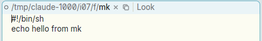
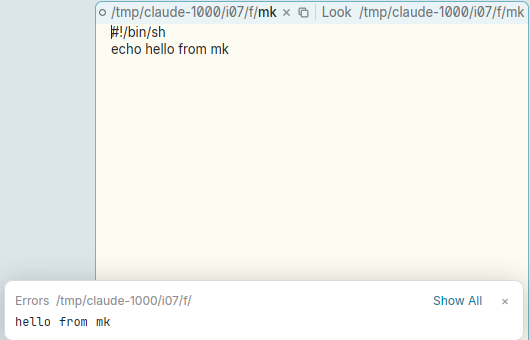

# B2 on the window's path in the tag does nothing: no execute, no sweep

**Type:** bug
**Area:** tag, mouse

## Summary

In acme the window's name is ordinary text at the start of the tag, so
middle-clicking it (or a word in it, or a B2 sweep across part of it)
runs that text as a command. In Apex the path is drawn as a separate
"head" (a breadcrumb made of atoms: folders, name, label, verb icons)
in front of the editable tag text. Button 2 on any part of that head
other than a verb icon is ignored. Nothing runs, nothing is
highlighted, and you can't sweep. The same text typed into the tag's
own text area does run.

## Steps to reproduce

1. Make an executable script: `mkdir -p /tmp/x && printf '#!/bin/sh\necho hello from mk\n' > /tmp/x/mk && chmod +x /tmp/x/mk`.
2. Open it in Apex: `apex open /tmp/x/mk`. The tag reads `/tmp/x/mk × ⧉ | Look`.
3. B2-click the name `mk` in the tag's path.
4. B2-click a folder of the path (e.g. `x`).
5. Press B2 on the path's start and drag over the whole path, then release.
6. As a control, click after `Look`, type ` /tmp/x/mk` and B2-click the typed `mk`.

## Expected behaviour

As in acme, steps 3 and 5 run `/tmp/x/mk` in the window's directory. For
a click, acme expands to the whole path, because `/` and `.` count as
characters of a command to execute. Its output `hello from mk` goes to
`/tmp/x/+Errors`. During step 5 the swept text is highlighted in the B2
colour, and on release it runs whatever was swept. In step 4 acme would
run the path expanded around the click (the same word). If it were
limited to the folder, it would at least do something visible.

## Actual behaviour

- Steps 3, 4 and 5 do nothing. No command runs, no `+Errors` window
  appears, and `apex ps` and `apex win` are unchanged. A B2 drag across
  the path shows no sweep highlight.
- Step 6, the control, works. The `+Errors` window for `/tmp/x/` opens
  and shows `hello from mk`.

So only the drawn path (and label, and Untitled) ignores B2. B2 on the
verb icons and on the tag text after the `|` works normally.

## Screenshots

While B2 is held and dragged across the path, nothing is highlighted.
Releasing it runs nothing:

The same path typed after `Look` and B2-clicked runs the script. Its
output appears in the Errors toast:

## Notes

- Reproduced on Linux/X11 in a nested Xephyr, with prebuilt
  `target/apex-linux/bin/apex-ui` from branch `001-linux-support` and a
  private daemon. I drove the mouse with xdotool. The test file was
  `/tmp/claude-1000/i07/f/mk`.
- This looks like a gap in the design rather than an accident. DESIGN.md
  ("The client draws a tag's head…"), MODERN.md ("The path is a
  breadcrumb") and docs/userguide.html list what B1 and B3 do on the
  path: B1 opens the picker, a double-click makes it a field, and B3
  plumbs it. None of them say anything about B2. The tag's own text is
  "the user's words alone", so the path is not tag text at all.
- Code pointer: `Acme::press_atom` in
  `crates/apex-client/src/tagedit.rs:168` handles B2 only for
  `Atom::Verb`. `(MouseButton::Middle, Atom::Dir(_) | Atom::Name |
  Atom::Untitled | Atom::Label)` falls through to `_ => {}` (line 196).
  No B2 sweep is started for the head either. Compare the
  `Target::View`/`Region::Text` B2 path in
  `crates/apex-client/src/app.rs` around line 3546.
- Related, filed separately: selecting or copying the path in the tag
  is in `13-tag-filename-select-copy.md`, and the oddities of editing
  it are in `20-tag-filename-editing-weird.md`. All three come from the
  path not being ordinary tag text.

## Fix

B2 pressed on a folder or the name of a tag's path now executes the
window's whole name when it is released on the path, exactly as B2 on
that word in acme's tag would (`Acme::press_atom` records `head_b2`;
`Acme::release_head` in app.rs runs `execute(ExecCtx::Window(w), path)`,
the same call B2 on tag text makes, so same cwd, +Errors and builtins).
B1 clicked while B2 is held is the 2-1 chord: the selection is appended
as the argument. While held, and fading after it ran, the path is
washed in B2's sweep colour. Released off the path, nothing runs. A B2
sweep over part of the path is not supported (the head is not text);
the click always takes the whole name, as acme's word expansion does.
The B1-B2 snarf chord is unchanged. The fix is in the commit containing
this section.
