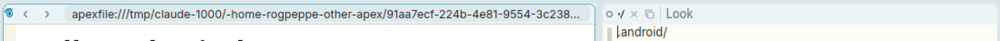
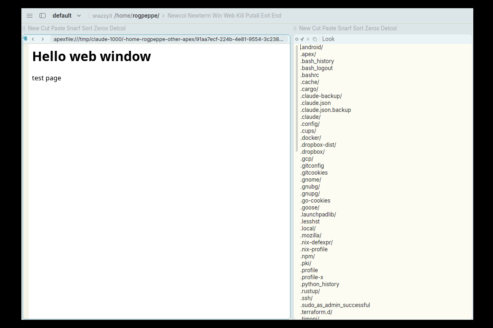

# A web window's header has no Del, and Ctrl+W over the page does nothing

**Type:** bug
**Area:** web windows, tag

## Summary

A web window (one opened with `Web`, `Newweb URL` or `apex web open URL`)
draws a browser-style header where its tag would be: the handle, ‹ and ›
buttons, and an address pill. Nothing else is there. It has no `Del` word
or × icon, and clicking anywhere in the header only edits the address,
so `Del` can't be typed and executed. Ctrl+W (the `Del` key) works with
the pointer over the header but does nothing with the pointer over the
page itself, because WebKitGTK has the keyboard there. You can still
close the window from the menu (≡ → File → Del) or with `apex win del`,
but in day-to-day use a web window looks impossible to delete.

## Steps to reproduce

1. Start Apex on a fresh session.
2. Open a web window, either by typing and B2-ing `Web /some/file.html`
   in the top row, or from a shell:
   `apex web open file:///tmp/hello.html`.
3. Look at the web window's tag for a `Del` word or × icon (other
   windows have one, e.g. the directory window's `·/ × ⧉ … Look`).
4. Click in the header after the address to type `Del`. The address
   pill grabs the click and selects the whole URL as text to edit.
   Press Escape.
5. Move the pointer over the page body (wait a second), then press Ctrl+W.
6. Move the pointer over the header (the address pill), then press Ctrl+W.

## Expected behaviour

WEB.md §2.1 says: "`Del` closes it as any window." In acme
every window's tag holds `Del`, and you close a window by B2 on that word.
The web window should offer the same: a `Del` / × in its header as other
windows' tags have, or some other way to reach the tag's words. Ctrl+W
should delete the window under the pointer whether the pointer is over
the header or the page, since keys follow the pointer everywhere else.

## Actual behaviour

- Step 3: there is no `Del` and no × in the header. The address takes
  up all the space after the ‹ › buttons (see screenshot).
- Step 4: clicking the header starts editing the address, so nothing
  else can be typed there.
- Step 5: Ctrl+W with the pointer over the page does nothing. The window
  stays (`apex win` still lists it as `page`), and the page eats the key.
- Step 6: Ctrl+W with the pointer over the address pill deletes the window.
- The menu (≡ → File → Del, Ctrl+W) also deletes it, and so does
  `apex win del WIN`.

So you can close a web window, but only in ways that aren't visible
from the window itself. The obvious ways (acme's `Del` in the tag, the
× other windows show, Ctrl+W while looking at the page) don't work.

## Screenshots

The web window (left) next to a directory window (right). The directory
window's tag has × (Del); the web window's header has only the handle,
‹ ›, and the address:

The whole screen:

## Notes

- Environment: Linux, X11 (nested Xephyr), WebKitGTK, prebuilt
  `target/apex-linux/bin` from branch `001-linux-support` (afce379).
- Reproduced: yes. Steps 3–5 behave as described every time. Step 6 and
  the menu do delete the window.
- Likely code: `crates/apex-client/src/webbar.rs:87` (`web_header`). Its
  doc comment says the header has "the address, and nothing else -- no
  tag text". `crates/apex-client/src/main.rs:401-404` draws that header
  in place of the tag's `TextElement` for every `Body::Page(Source::Url)`,
  so the core tag's verbs (including `Del`, which `app.rs:3104` turns
  into the × icon for other windows) are never shown. For Ctrl+W over
  the page, the timer in `app.rs:1707` (`web_focus_tick`) hands the
  keyboard to the WebKit view under the pointer, and the `secondary-w`
  binding (`shell.rs:284`) never sees the key.

## Fix

- The web header (`webbar.rs` `web_header`) now ends with the tag's ×
  icon (`VERB_ICONS` "Del", or the stacked variant over another
  window), drawn with `sidebar::icon_element`; B1 or B2 on it runs
  `Del` in the window.
- The header records its bounds in `Acme::web_heads`, and
  `window_at_pointer` uses them: before, no tag layout existed under the
  header, so Ctrl+W there acted on the last selected text's window
  (which is why step 6 sometimes appeared to work, and sometimes closed
  a different window or did nothing).
- Linux only: each WebKitGTK view gets a `key-press-event` handler that
  runs before WebKit's (`web::page_shortcut`). A control key that is one
  of the app's bindings (`shell::app_shortcut`), other than Copy, Cut,
  Paste, Select All, Undo and Redo, is kept from the page and dispatched
  to gpui (`WebEvent::Key`, then `Window::dispatch_keystroke` on the
  next render). So Ctrl+W over the page is `Del`, while Ctrl+C/V/X/A/Z
  stay the page's.

The commit containing this section is the fix.
