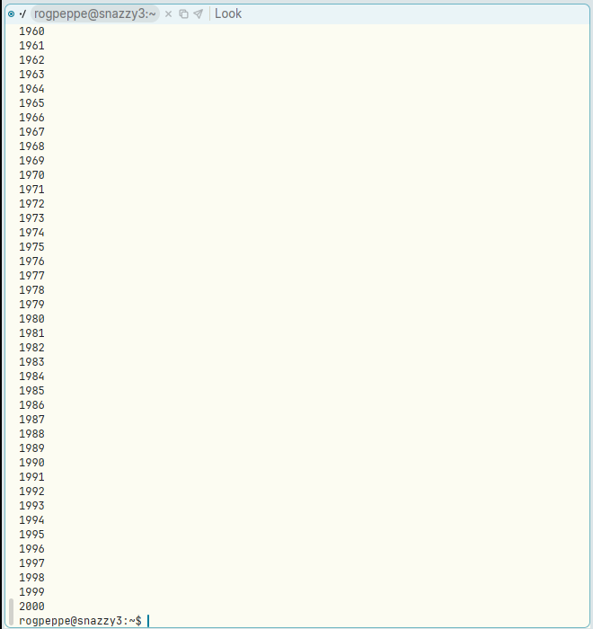
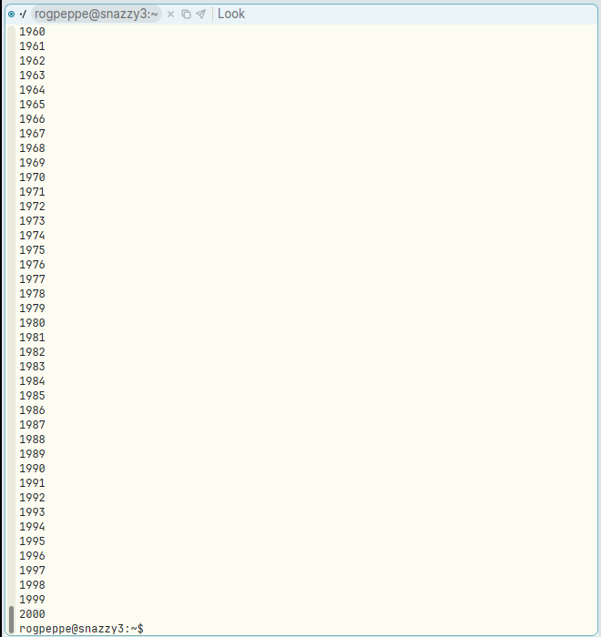
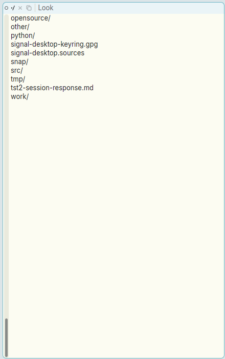

# Button 2 in a Term window's scrollbar does nothing

**Type:** bug
**Area:** terminal, mouse, scrollbar

## Summary

In a Term window, clicking or dragging with button 2 in the scrollbar does
nothing. It should jump to the place in the scrollback as far down as the
pointer is down the bar, as it does in Apex's text windows and in acme. Buttons
1 and 3 in the same scrollbar work.

## Steps to reproduce

1. Start Apex. Click `Newterm` in the top tag with B2 to open a Term window.
2. In the terminal, run `seq 1 2000`. The window now shows the end of the
   output (1960–2000 and the prompt), with the scrollbar thumb at the bottom.
3. Click B2 in the Term window's scrollbar about a quarter of the way down.
4. Also try holding B2 in the scrollbar and dragging it up and down.
5. For comparison, click B2 in the scrollbar of an ordinary text window, such
   as the directory listing of `~`.

## Expected behaviour

As in acme (and in Apex text windows): B2 in the scrollbar shows the part of
the text as far down as the pointer is down the bar. Clicking a quarter of the
way down should show the area around line 500 of the scrollback. Holding B2 and
dragging should keep scrolling to follow the pointer.

## Actual behaviour

- B2 click: the Term window doesn't change. It still shows 1960–2000.
- B2 drag: nothing happens.
- B1 / B3 in the same scrollbar work: they scroll back or forward by the
  number of lines the pointer is down the bar (for example, 1960 → 1942 and
  back again).
- B2 in a text window's scrollbar works: it jumps to the right place in the
  listing.

## Screenshots

Term window before the B2 click (thumb at the bottom):

After B2 a quarter of the way down the scrollbar. Nothing has changed:

For comparison, a text window after the same B2 click on its scrollbar. It
jumped to the end of the listing as expected:

## Notes

- Reproduced on Linux/X11 (nested Xephyr) with the prebuilt binaries from
  branch `001-linux-support` (at `afce379`).
- Likely cause: in the mouse-down dispatch for Term targets,
  `crates/apex-client/src/app.rs:3590-3592`, `start_scrolling` is called for
  `(Region::TermScrollbar, MouseButton::Left)` and `(…, MouseButton::Right)`,
  but there is no arm for `MouseButton::Middle`. So B2 falls into `_ => {}`.
  The B2 case is already written: `term_scrollbar_click`
  (`app.rs:4915`, `dir == 0` branch) and `scroll_step` (which maps
  `Middle` to `dir 0`). It just never runs. Text views (`app.rs:3551`) and web
  views have the Middle arm.

## Fix

The Term mouse-down dispatch in `crates/apex-client/src/app.rs` now has a
`(Region::TermScrollbar, MouseButton::Middle)` arm that calls
`start_scrolling`, as the B1 and B3 arms do. The existing `dir == 0` branch of
`term_scrollbar_click` then does the positioning, and holding B2 follows the
pointer through the shared `scroll_step` repeat loop, as in text windows. The
fix is in the commit that contains this section.

Note: the bar spans the history the terminal has kept, not everything ever
printed. In the GUI check, after `seq 1 2000` the oldest kept line was about
1063 (with `Newterm.scrollback` at its default of 10000 lines, so something
keeps less history than that setting says; not looked into here). So B2 a
quarter of the way down showed about line 1300, not line 500.
