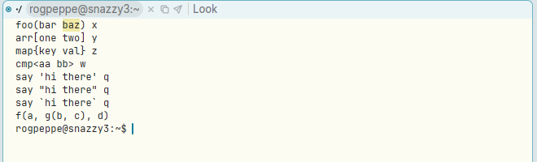
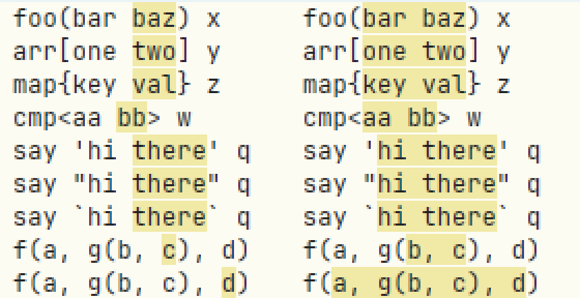
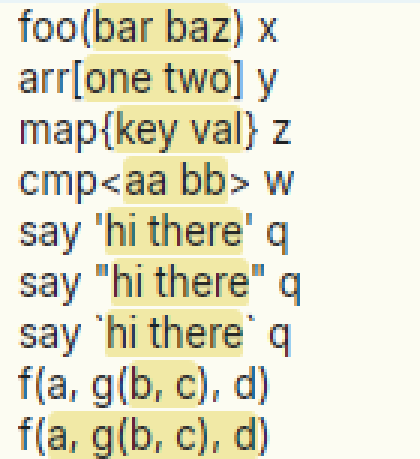

# Double-click just before a closing bracket or quote in a terminal doesn't select back to the opener

**Type:** bug
**Area:** mouse, terminal

## Summary

In acme, double-clicking just inside a bracket or quote selects everything
up to its match. That works from either end: just after `(` selects
forward to the `)`, and just before `)` selects back to the `(`. Apex text
windows do this correctly. Apex terminal windows don't. There, a
double-click just before `)`, `]`, `}`, `>` or a closing quote selects only
the word to its left. To get the match you have to click on the closing
character itself. The opening side works when you click on the first
character inside, so the two directions are out of step by one character.

## Steps to reproduce

1. Start Apex, then open a terminal with Newterm (or Ctrl+Alt+N).
2. In the terminal run `printf 'foo(bar baz) x\nf(a, g(b, c), d)\n'`.
3. Double-click with B1 on the right half of the `z` in `baz`, just
   before the `)`.
4. Now double-click on the `)` itself.
5. For comparison, open a file with the same text in an ordinary text
   window and double-click just before the `)`.

## Expected behaviour

Step 3 should select `bar baz`, as in acme (`textdoubleclick` in text.c)
and as in an Apex text window. The click point should be the character
boundary nearest the pointer, as it is in text windows. Every bracket kind
(`() [] {} <> «»`) and every quote (`' " \``) should behave the same way,
and nested pairs should work too. For example, just before the final `)` of
`f(a, g(b, c), d)` should select `a, g(b, c), d`.

## Actual behaviour

In the terminal, step 3 selects just `baz`. Step 4 (clicking on the `)`
itself) selects `bar baz`. I checked each kind:

| text | double-click just before closer | double-click on closer |
|---|---|---|
| `foo(bar baz)` | `baz` | `bar baz` |
| `arr[one two]` | `two` | `one two` |
| `map{key val}` | `val` | `key val` |
| `cmp<aa bb>` | `bb` | `aa bb` |
| `'hi there'`, `"hi there"`, `` `hi there` `` | `there` | `hi there` |
| `g(b, c)` inside `f(a, g(b, c), d)` | `c` | `b, c` |
| outer `)` of `f(a, g(b, c), d)` | `d` | `a, g(b, c), d` |

The opening side has the matching problem. A double-click on the first
character after `(` selects `bar baz`, which is right. A double-click on
the `(` itself selects `foo`.

In a text window, every case above selects the full bracketed or quoted
text when you click just before the closer, nested pairs included. I
checked this by scanning double-clicks across each line and reading the
selection back with `apex sel`.

## Screenshots

In the terminal, a double-click just before `)` selects only `baz`:

Terminal, every bracket and quote kind. The left column is a double-click
on the right half of the character before the closer. The right column is
a double-click on the closer itself.

In a text window, a double-click just before each closer works:

## Notes

- Environment: Linux, X11 (nested Xephyr), prebuilt binaries from branch
  `001-linux-support`. Reproduced in a terminal window. Could not
  reproduce in a text window with clean synthetic (xdotool) clicks.
- Likely cause: a terminal turns the pointer into a *cell*, not a
  character boundary. `TermLayout::cell_at`
  (`crates/apex-client/src/term_element.rs:26-27`) rounds x down to the
  cell under the pointer. `term_double_click`
  (`crates/apex-client/src/app.rs:5757`, `let q = starts[r] + c...` at
  :5775) then uses that cell's column as the click position. So clicking
  anywhere on `z` gives the position before `z`, never the one between
  `z` and `)`. Text windows use `offset_at`
  (`crates/apex-client/src/text_element.rs:884`), which picks the nearest
  boundary. The expansion itself, `apex_core::node::double_click`
  (`crates/apex-core/src/node.rs:105`), is a faithful port of acme's
  `textdoubleclick`/`textclickmatch` and handles both directions
  correctly. The text-window call site is `app.rs:3534`; the terminal
  one is `app.rs:3572`.
- A related issue may make text windows seem flaky with a real mouse.
  After the second press of a double-click, any pointer motion while B1
  is held runs the sweep code (`app.rs:3780`,
  `select(anchor.min(off), anchor.max(off))`). Even a 1px jitter
  therefore replaces the bracket selection with an empty one at the
  click point. I confirmed this with `xdotool mousedown 1;
  mousemove_relative 1 0; mouseup 1`, which affects the opening and
  closing sides alike. acme ignores motion of less than 3px after a
  double-click (text.c, `textselect`), keeping the double-click
  selection.

## Fix

A terminal double-click now expands from the boundary between cells
nearest the pointer (new `TermLayout::boundary_at` in
`crates/apex-client/src/term_element.rs`, rounding x to the nearest cell
edge), not from the start of the cell under it, as text windows do with
`offset_at`. Only the double-click's expansion point changed: single
click, sweeps, B2/B3 and the drag after a double-click (which still
remembers the pressed cell in `Mouse::term_dbl`) use cells as before.
New unit test `a_double_click_just_inside_either_bracket_selects_what_they_enclose`
in `app.rs`. The commit is the one containing this section.

The note about text windows losing the double-click selection on 1px
motion is issue 17.
