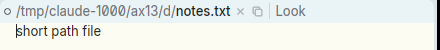
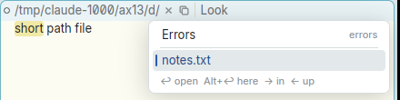
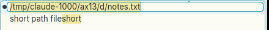

# The window's file name in its tag cannot be selected or copied

**Type:** bug
**Area:** tag, mouse, snarf/clipboard

## Summary

In acme the window's name is ordinary text at the start of the tag: you
can sweep it or double-click it with B1, and Snarf it (with the 1-2 chord,
`Snarf`, or the system copy key). In Apex the path is drawn from the
window's state and is not tag text. Every way of pointing at it does
something else: B1 opens the breadcrumb picker, a double-click opens the
rename field, and B3 plumbs the path. None of these gives a selection you
can copy. Even inside the rename field, where the path is shown as editable
and selected text, Ctrl-C does not copy it. So there is no way to take a
window's file name out of its tag.

## Steps to reproduce

1. Start Apex and open a file, e.g. `apex open /tmp/d/notes.txt`. The tag
   reads `○ /tmp/d/notes.txt × ⧉ | Look`.
2. To have something to check against, select a word in some body (e.g.
   `short`) and press Ctrl-C, so the snarf buffer holds `short`.
3. **Sweep.** Press B1 on `notes.txt` in the tag and drag across it.
4. Press Escape. **Double-click** `notes.txt`. The rename field opens with
   `notes` selected. Press Home, then Shift+End, to select the whole path.
   Press Ctrl-C, then Escape.
5. Click in a body and press Ctrl-V (or use `Paste`).
6. **Chord.** Press B1 on the name, then B2, then release both.

## Expected behaviour

As in acme, the name in the tag is text you can select and snarf like any
other:

- Step 3 highlights the swept part of the name, and B1-B2 (or `Snarf`, or
  Ctrl-C) puts it in the snarf buffer and on the clipboard.
- A double-click selects a word of the path, as it would anywhere else.
- Failing that, at the very least, Ctrl-C (Copy) in the rename field copies
  the selected text, as it does in Apex's other one-line fields (the
  finder, the command list, the URL field).

Pasting in step 5 should then give `notes.txt` or `/tmp/d/notes.txt`.

## Actual behaviour

- **Sweep (step 3):** the B1 press opens the breadcrumb picker at once. The
  name is taken out of the tag, and a query caret takes its place after
  `/tmp/d/`. The drag does nothing, and nothing is selected.
- **Double-click (step 4):** the rename field appears, and its text can be
  selected with the keyboard. But Ctrl-C does nothing to the clipboard.
- **Paste (step 5):** inserts `short`, the sentinel. Neither the stem nor
  the whole path was copied. I tried both a stem-only and a whole-path
  selection.
- **Chord (step 6):** B1 opens the picker, and B2 then closes it and moves
  the tag's caret to before `Look`. Nothing is snarfed.
- The `⧉` (Snarf) icon in the tag is acme's `Snarf` of the window's *body*
  selection, not the path.
- B3 on the name plumbs the path, so it opens or shows the file. It does
  not select or copy anything.

The only way to get the path today is from outside the tag, e.g.
`apex win` in a terminal.

## Screenshots

The tag. The path is drawn as a head, not as tag text:

B1 pressed and dragged across `notes.txt`. The picker comes down, the name
leaves the tag, and nothing is selected. (`short` is highlighted in the
body: that is the sentinel snarf from step 2.)

The rename field with the whole path selected. Ctrl-C here does not copy
it, and a later paste gave `short`.

## Notes

- **Environment:** Linux, X11 (nested Xephyr), the prebuilt binaries in
  `target/apex-linux/bin` from branch `001-linux-support` (afce379).
  Reproduced.
- **Why it happens:** this follows from the "windows are what they are"
  redesign (DESIGN.md, *Windows are what they are*; MODERN.md, *A tag is
  what the window is, then your words*). The path is window state drawn as
  head atoms, and is no longer the tag's first word, so the tag's text
  selection never covers it.
- **Code pointers:**
  - Head clicks: `crates/apex-client/src/tagedit.rs:168` (`press_atom`). B1
    on `Atom::Dir`/`Atom::Name` opens the picker on press (line 183), a
    double-click opens the rename field, and B3 plumbs. Nothing there
    selects or snarfs.
  - Copy in the rename field: `menu_edit`
    (`crates/apex-client/src/app.rs:5259`) only sends Copy, Cut, Paste and
    Select All to a field for the overlays listed at line 5262, through
    `overlay_field` (`crates/apex-client/src/shell.rs:1525`). The tag-edit
    field (`self.tag_edit`) is not among them, so Ctrl-C copies whatever
    the text under the pointer has selected instead. `claims_control`
    (`app.rs:5169`) lets only the emacs keys reach the field.
- **Possible directions (not a fix):**
  - Let the 1-2 chord or Snarf on the head copy the path.
  - Make the head's path sweepable text.
  - At minimum, include `tag_edit` in `overlay_field`, so Copy works in the
    rename field.
- **Related:**
  - `07-execute-text-in-tag-filename.md`: B2 on the file name.
  - `20-tag-filename-editing-weird.md`: the rename field's behaviour.

  This issue is only about selecting and copying the name.
- **Unconfirmed:** during one early attempt, a B1-B2 chord on the name ran a
  word from the body (`path`) as a command, and an Errors window appeared.
  This did not happen again on a clean retry, so it may have been leftover
  button state from earlier xdotool input (an Alt modifier had got stuck in
  the nested server at one point). I haven't confirmed it.

## Fix

- The Edit menu's Cut, Copy, Paste, Select All and Undo (Ctrl-X/C/V on
  Linux, ⌘ on the Mac) now go to the field that has the keyboard when that
  is a field in place: the tag's rename field (path or label), the path
  picker's or the directory picker's query, or the session's name. They
  used to go to the text under the pointer. (`Acme::has_field`,
  `overlay_field`, `menu_edit`, `menu_command`.)
- The 1-2 chord on the path in the tag (B1 on the name or a folder, then
  B2 while B1 is held; or ⌥ while B1 is held) snarfs the path up to the
  part pressed (the whole path from the name) into the snarf buffer and the
  clipboard, and puts away the picker the B1 press opened
  (`Acme::snarf_head`, `head_b1`). The breadcrumb head itself is unchanged:
  there is still no sweep-to-select of part of the name.

The fix is in the commit that moved this file to FIXED/.
