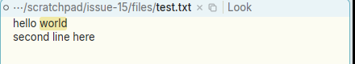
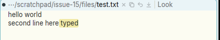

# Escape does not cut a non-empty selection

**Type:** bug
**Area:** keyboard / text editing

## Summary

In acme, Escape does two things. If text has been typed since the last
mouse action, it selects that text. If the selection is already non-empty,
it cuts the selection (deletes it and puts it in the snarf buffer). Apex
does only the first. When text is already selected, Escape does nothing,
so the usual acme idiom of selecting text and pressing Esc to cut it does
not work. Neither does typing, then Esc, then Esc again to take the typed
text back out.

## Steps to reproduce

Case A, selected text:

1. Open a file containing `hello world` (e.g. `apex open test.txt`).
2. Drag with button 1 over `world` so that it is selected.
3. Press Escape.

Case B, typed text:

1. Click with button 1 at the end of a line and type ` typed`.
2. Press Escape. ` typed` becomes selected, which is correct.
3. Press Escape again.

## Expected behaviour

As in acme:

- Case A: `world` is cut. It is removed from the body, the snarf buffer
  holds `world`, and the window becomes dirty.
- Case B: the first Escape selects ` typed`. The second Escape finds a
  non-empty selection and cuts it, so ` typed` is removed and snarfed.

In acme's `texttype` (text.c), every key that is not a movement key,
Escape included, first does `cut(t, t, nil, TRUE, TRUE, nil, 0)` when
`q1 > q0`, then resets `eq0`. After that the `Kesc` case finds no typed
text to select. So Esc on a selection is a cut with snarf, and it can be
undone with Undo or put back with Paste.

## Actual behaviour

- Case A: nothing happens. `world` stays selected and the text is
  unchanged. `apex sel` gives `6 11` both before and after the Escape.
- Case B: the first Escape selects ` typed` as expected (`apex sel` goes
  from `34 34` to `28 34`). The second Escape does nothing: the selection
  stays `28 34` and the text still reads `second line here typed`.

## Screenshots

Case A, `world` selected before Escape:

Case A, after Escape, unchanged (it should read `hello `):

Case B, after typing ` typed` and pressing Escape twice. The first Escape
selected the typed text and the second left it in place:

## Notes

- Reproduced on Linux under X11 (Xephyr), using the prebuilt binaries from
  the `001-linux-support` branch (`target/apex-linux/bin`). The keys and
  clicks were sent with xdotool.
- Likely code: `crates/apex-client/src/app.rs:5461`. The `"escape"` arm
  only acts when `typed_start` has an entry for the view. It selects
  `typed_start..q1` and otherwise does nothing. There is no branch that
  cuts when `q0 < q1`. To match acme, a non-empty selection should be cut
  (with snarf) before the typed-text check.
- The user guide (`docs/userguide.html:300`) describes Escape only as
  "select what was just typed". It would need updating along with the fix.

## Fix

The `"escape"` arm of `text_key` in `crates/apex-client/src/app.rs` now
cuts a non-empty selection first, through the same `cut` helper as ⌘X
(core `node.cut`, so it is undoable, plus the snarf buffer and the
system clipboard), and forgets `typed_start` for the view. Only with an
empty selection does Esc select what was typed. This is acme's order in
`texttype`. It applies in bodies, tags and the other text views;
terminals are unchanged, since their keys go to the program. The user
guide and the client-input wiki page say so. The commit containing this
section has the change.
