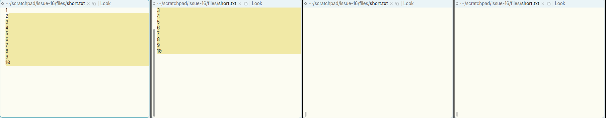
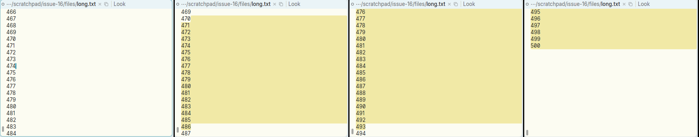
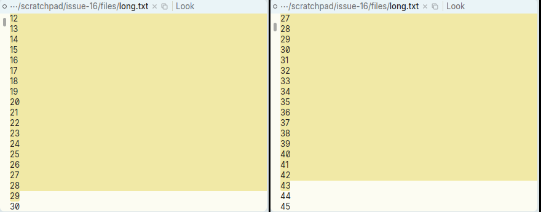

# Selection autoscroll runs past the end of the text, and speeds up each time the pointer recrosses the edge

**Type:** bug
**Area:** mouse (B1 selection sweep / autoscroll)

## Summary

If you sweep a B1 selection and drag below the bottom of a window body, Apex
autoscrolls, as acme does. It does not stop when the end of the text comes on
screen, though. It keeps going until every line has scrolled off the top and the
window is blank. This happens even in a file short enough to fit the window,
where no scrolling is needed at all. Separately, each time the pointer leaves
the body, comes back in and leaves again, another scroll timer starts, so the
scroll gets about three times faster after a little back-and-forth at the edge.
Scrolling does stop correctly when the pointer comes back inside the body and
when the button is released.

## Steps to reproduce

Short file (no scrolling should happen):

1. `seq 1 10 > short.txt`, then `apex open short.txt` so it is the upper window
   in a column, with another window below it.
2. Press B1 on line 2 and drag down past the last line of short.txt, then on
   past the bottom of its body into the window below. Keep the button held.
3. Wait about 1.5 s, then release.

Long file, end of text:

1. `seq 1 500 > long.txt`, open it as the upper window of a column, and scroll
   so that line ~466 is at the top.
2. Press B1 on a line, drag about one line below the bottom of the body, and hold
   for about 3 s.

Edge crossings:

1. In long.txt scrolled to the top, press B1 on line 5 and drag just below the
   body bottom (about 12 px, so one line per tick).
2. Cross the bottom edge a few times: out, in, out, in (each about 20 ms),
   then hold just outside.
3. Compare how fast it scrolls with a plain drag-out-and-hold.

## Expected behaviour

acme's `framescroll` (text.c) refuses to scroll forward once the end of the file
is in the frame (`if(t->org+t->fr.nchars == t->file->b.nc) return;`). Dragging
below a window therefore scrolls only until the last line is visible. With a
short file nothing scrolls at all. The scroll rate should depend only on how
far the pointer is past the edge, not on how many times it has crossed it.

## Actual behaviour

- **Short file:** all 10 lines scroll off the top within about 1.5 s and the
  window body is left empty. Afterwards the selection is `3 21`, i.e. lines 2
  to 10.
- **Long file:** scrolling carries on past line 500. After about 2.4 s only
  495–500 are left at the top. After 3 s the body is blank, with just the tick
  at end of file.
- **Edge crossings:** measured as how far the selection grew during one second
  of steady hold, 12 px below the edge:

  | edge crossings before the hold | lines scrolled in 1 s |
  |---|---|
  | 0 | 10, 11 |
  | 3 | 30 |
  | 6 | 33 |
  | 12 | 30 |

  So the scroll gets about 3× faster. (Here it levelled off around 30 lines/s,
  probably because of the frame rate under Xephyr.)
- Scrolling did stop as soon as the pointer came back inside the body, and on
  release. In my tests it never kept going after the button was up. In one run
  a directory window scrolled one more line on release, because the selection
  was extended to the line under the pointer. This is minor.

## Screenshots

Short file. From left to right: dragging inside the body; just below the body;
1.5 s later, all text gone; after release.

Long file near its end. From left to right: before; 0.3 s; 0.9 s; 2.4 s, with
only 495–500 left and still going.

Long file after 1 s of holding 12 px below the edge. Left: plain drag, top line
12. Right: after 6 quick edge crossings, top line 27.

## Notes

- Reproduced on Linux under X11 (Xephyr, 1200x800), with the prebuilt
  `target/apex-linux/bin/apex-ui` from branch 001-linux-support.
- Likely code is in `crates/apex-client/src/app.rs`:
  - `autoscroll_step` (around line 4222) calls `scroll_by(v, dir * lines)`
    without checking whether the end of the text is already visible.
    `scroll_by` (around line 3322) and `row_from` let the origin move right up
    to the end of the buffer.
  - In the drag handler (around lines 3783–3806), moving back inside sets
    `mouse.autoscroll = None`, and going out again sees `fresh` and spawns a new
    80 ms timer loop. The old loop only exits when a tick finds `autoscroll`
    set to `None`. If the pointer goes out again before that tick, both loops
    keep running, each calling `autoscroll_step`.
- Also noticed: dragging below the *bottom-most* window, out of the app window
  altogether, gave no autoscroll at all. Motion past the X window edge does not
  seem to reach the app. acme scrolls when the pointer is at or below the
  frame's bottom edge. This may be worth a separate look.

## Fix

- `autoscroll_step` (crates/apex-client/src/app.rs) no longer scrolls down
  once the end of the text is in view, as acme's `framescroll` refuses to; the
  selection still follows the pointer to the edge. The test is the new
  `TextLayout::end_shown` (crates/apex-client/src/text_element.rs): the rows
  laid out reach the end of the text and the last line (not counting the empty
  one after a final newline) is wholly inside the body. Upward autoscroll
  already stopped at the top, since `row_from` clamps at the first row.
- Each autoscroll timer loop now carries a generation number
  (`Acme::autoscroll_gen`, bumped whenever a fresh loop starts). A loop whose
  generation is no longer the current one exits at its next tick, so there is
  only ever one loop per drag, whatever the pointer does at the edge.
- Terminals have no selection autoscroll, so neither bug applies there.
- Not fixed: dragging out of the app window altogether gives no autoscroll.
  The root view's handler is attached with gpui's `on_mouse_move`, which only
  fires while the element's hitbox is hovered, so motion events outside the
  window (which X11 does deliver during the implicit grab) never reach
  `mouse_move`. Inside the window it works down to the last pixel row.

The commit is the one containing this section.
