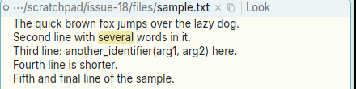
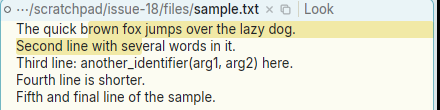
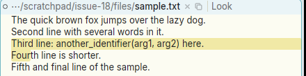

# Triple-click should select the whole line, and dragging after it should extend by lines

**Type:** feature request
**Area:** mouse, selection

## Summary

Apex has no triple-click. Any click with `click_count >= 2` is a
double-click, so a third click just selects the word under the pointer
again. If button 1 stays down after that third click and the pointer moves,
the selection is thrown away and a plain character sweep starts from the
exact click point. The proposal: a triple-click selects the current line,
newline included, and dragging with the button still down extends the
selection a whole line at a time. This is the line-level version of
`17-double-click-drag-by-words.md`.

## Current behaviour

To reproduce, open a file holding:

```
The quick brown fox jumps over the lazy dog.
Second line with several words in it.
Third line: another_identifier(arg1, arg2) here.
Fourth line is shorter.
Fifth and final line of the sample.
```

1. Triple-click in the middle of `several` on line 2. Only `several` is
   selected (offsets 62–69), exactly as a double-click would select it. The
   line is not selected.
2. Triple-click on the `e` of `several` and keep button 1 down. Drag up into
   line 1. The selection becomes `rown fox jumps over the lazy dog.\nSecond
   line with sev` (11–65). It runs from the click point to the pointer's
   character, so it cuts both `several` and `brown` in half. Neither the
   word nor any whole line is kept.
3. Triple-click at the very start of line 3 (left of `Third`). Here
   acme's double-click rule for line ends applies, so the whole line with
   its newline is selected (83–132). Hold the button and drag down into
   line 4: the selection becomes `Third line: ...here.\nFour` (83–136). The
   drag goes on by characters, not lines.

So today the only way to get a whole line from the mouse is acme's
double-click at the start or end of a line. There is no way to grow a
selection a line at a time.

acme has no triple-click either. Its `textselect` (text.c) only recognises
a double-click, and a drag after it is a character sweep from the click
point. So this is a modern addition, like issue 17. Acme users lose
nothing by it, because a third click does nothing useful today.

## Proposed behaviour

When button 1 goes down as the third click of a multi-click in a text
(body or tag) window (`click_count >= 3`, within the platform's
multi-click time and distance):

- Select the line containing the click, from the character after the
  previous `\n` (or the start of the text) through the next `\n`
  inclusive (or the end of the text if the last line has no newline).
  Call it the *base* range `[b0, b1)`.
- While button 1 is held, if the pointer is at offset `p`:
  - inside `[b0, b1)`: the selection stays `[b0, b1)`;
  - after `b1`: the selection is `[b0, line_end(p))`, where `line_end`
    includes `p`'s line's newline;
  - before `b0`: the selection is `[line_start(p), b1)`.
- The selection never shrinks below the base, and moving the pointer a
  pixel or two after the third click must not lose it. This is the jitter
  problem from issue 17 step 4.
- "Line" means a text line (up to `\n`), not a wrapped display row. That
  way the selection is the same whatever the window width, and a
  triple-click on a long wrapped line takes all of it.
- A fourth click and beyond can either stay at line granularity (as in
  most editors) or cycle back. Staying at line granularity is the simpler
  and more usual choice.
- Chords (B1+B2 cut, B1+B3 paste) and autoscroll past the window edge
  work as they do for a normal sweep. A triple-click and B1+B2 then cuts
  whole lines.
- Terminal windows do the same over screen rows: a triple-click selects
  the row (or the logical line, if Apex tracks soft wraps there) and
  dragging extends by rows. Today a click in a terminal with
  `click_count >= 2` does `term_double_click` and starts no drag at all.

This should share the mechanism proposed in issue 17. `Drag` would carry a
base range and a unit (character, word, line). The click count picks the
unit: 1 is character, 2 is word (acme's `double_click`), 3 is line. The
mouse-move code then rounds the pointer's offset out to that unit.

## Rationale

Selecting whole lines is a very common operation: to cut or move a block,
to pipe it through `|sort` or another command, or to send it to a
terminal. In Apex today it takes a careful sweep from column 0 of the
first line to just past the newline of the last line, or a double-click
exactly on a line boundary that cannot then be extended. Triple-click to
select a line, then drag by lines, is what users of nearly every other
editor, browser and terminal (xterm, GTK, VS Code) will expect.

## Screenshots

Taken in Apex built from the branch, on the text above.

1. Triple-click in `several`. Only the word is selected (62–69), as with
   a double-click:

   

2. Triple-click on the `e` of `several`, held and dragged up into line 1.
   A character sweep from the click point (11–65):

   

3. Triple-click at the start of line 3 (the line is selected, as acme's
   double-click selects it), held and dragged down into line 4. The drag
   extends by characters to `Four` (83–136), not to the end of line 4:

   

## Notes

- Linux, X11 (Xephyr 1200x800), prebuilt `apex-ui` from branch
  `001-linux-support`. Reproduced. The offsets above were read with
  `apex sel` while the button was held.
- Where the code is:
  - `crates/apex-client/src/app.rs:3532` (`mouse_down`, `Region::Text`):
    `if e.click_count >= 2` calls `apex_core::node::double_click`, so a
    third click is treated as a second. It then stores
    `Drag { view, anchor: off }`, which keeps only the click offset.
  - `crates/apex-client/src/app.rs:3775` (`mouse_move`): it selects
    `anchor.min(off)..anchor.max(off)` with no notion of a unit.
  - The terminal path is at `app.rs:3567`, where `click_count >= 2` goes to
    `term_double_click` and starts no drag.
- See also `17-double-click-drag-by-words.md`. The two should be
  implemented together.

## Fix

A B1 press with `click_count >= 3` (a fourth click and on too: it stays
at the line, as most editors do) now selects the text line under the
pointer through its newline (`apex_core::node::triple_click`), whatever
the wrapping, and records `Drag { base, unit: Unit::Line }`. While B1 is
held, `node::sweep` by the line joins the base with the whole line the
pointer is on, so the selection grows a line at a time up or down and
never drops below the triple-clicked line; jitter can't lose it. Tags work
the same over their text lines. Terminals select the logical line (rows
soft-wrapped into one, `term_multi_click`) and grow by lines
(`term_unit_sweep`). Chords and autoscroll act on the grown selection.
The user guide and docs/wiki/client-input.md describe it. The commit is
the one containing this section.
