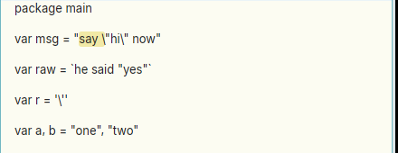
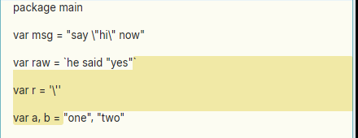
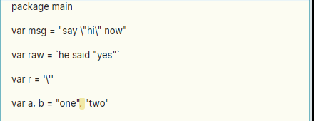

# Double-click selection should understand the file's language (string literals, comments)

**Type:** feature request; **Area:** mouse, selection

## Summary

A double-click next to a quote finds the nearest matching quote character. It knows nothing
about escapes, about which quote opens a literal and which closes it, or about the quote kinds
a language uses. So in source code, double-clicking at the edge of a string literal often selects
part of it, or text *between* two literals. When the language is known (Go is the obvious first
case), the double-click should select the literal the user clicked on: a raw string `` `...` ``
(which may span lines and contain `"`), an interpreted string with escaped quotes, a rune
literal, or a comment.

## Current behaviour

`apex_core::node::double_click` is a direct port of acme's `textdoubleclick`/`textclickmatch`.
For `'`, `"` and `` ` `` it checks the character to the left of the click first. If that is a
quote, it scans right to the next identical character. Otherwise, if the character to the right
is a quote, it scans left. It never looks at backslashes, and it can't tell an opening quote
from a closing one.

Repro, with a fresh Apex window and this file open (`q.go`):

```go
package main

var msg = "say \"hi\" now"

var raw = `he said "yes"`

var r = '\''

var a, b = "one", "two"
```

1. Double-click just inside the opening `"` of `msg`'s value. The selection is `say \`
   (offsets 25–30), not `say \"hi\" now`.
2. Double-click just inside the closing `` ` `` of `raw`, between `"` and `` ` ``. The `"` to
   the left is taken as an opening quote, and the selection runs from there to the first `"`
   of `"one"` two lines down (offsets 66–94).
3. Double-click just after the closing `"` of `"one"`. The selection is `, ` (the gap between
   the two literals), not `one`.
4. Rune literal `'\''`: a click just inside the first `'` selects `\`.

All four were reproduced. The offsets come from `apex sel`.

## Proposed behaviour

When a double-click lands next to a quote or a comment delimiter, and the window's file has
a known language, the selection should follow that language's lexical rules. Otherwise it
falls back to acme's rule exactly as now.

- **Find the token from the start of the context, not from the click.** Lex forward from a
  known-safe point to the clicked position, tracking whether it is inside a string, rune,
  raw string or comment. Use the start of the file for small files. For big ones, use a
  bounded window such as the start of the enclosing top-level declaration, or N lines back.
  This lexer tracks only strings, comments and escapes, not a full parse. It tells you
  whether the quote next to the click opens or closes a literal.
- **Inside edge of a literal: select its contents.** This matches acme's convention of
  selecting what the quotes enclose. A click just inside either delimiter of `"say \"hi\" now"`
  selects `say \"hi\" now`. For `` `he said "yes"` `` it selects `he said "yes"`, even across
  newlines. For `'\''` it selects `\'`.
- **Comments:** a click just after `//` selects to the end of the line. A click just inside
  `/*` or `*/` selects the comment body.
- **Outside a literal:** a click just outside a closing quote (case 3) should not pair it with
  the next literal's opening quote. Acme's rule is to look left first. With the lexer, that
  becomes: a quote that closes a literal pairs only with that literal's opening quote. So a click
  right after `"one"` selects `one`, as the scan-left branch would if it ran first. A click
  between two literals that is next to neither quote falls through to the word rule.
- **Brackets inside literals and comments** should not count when matching `(`/`{`/`[` outside
  them. For example, `f(")")` with a click just inside `f(` should select `")"`.
- **Language selection:** use the window's file extension. Apex already maps extensions to
  languages for LSP (`apex-tool-lsp`'s `Language` table, `lsp.ID.ext` settings). That table, or
  a small shared one in `apex-core`, can choose the lexer. Start with Go. C, Rust, shell/rc and
  Python share most of the rules: C-style escapes and comments, Rust's `r#"..."#`, Python's
  triple quotes, rc's `'...'` with `''` as the escape.
- Terminal windows and files of unknown type keep acme's behaviour unchanged.

## Rationale

Selecting a whole string literal is a frequent action in code: copying a message, an
import path or a regexp, or using it as a Look or Edit argument. In Go, raw strings commonly hold
`"` (JSON, struct tags, test data) and interpreted strings commonly hold `\"`. Those are exactly
the cases where acme's character matching gets it wrong. A small lexer handles every case above,
with no LSP round trip, so the double-click stays synchronous.

## Screenshots

Case 1, escaped quote: the selection stops at `\`.



Case 2, a click inside the closing backtick of a raw string selects across lines to the next `"`.



Case 3, a click after the closing quote of `"one"` selects the gap between the literals.



## Notes

- Environment: Linux, X11 (nested Xephyr), prebuilt `target/apex-linux/bin` from branch
  `001-linux-support`. The current behaviour was reproduced by double-clicking with xdotool and
  reading the selection with `apex sel`.
- Code: `crates/apex-core/src/node.rs:105` (`double_click`) and `click_match` below it.
  The caller is `crates/apex-client/src/app.rs:3534`. Terminals also use it via
  `term_double_click` (`app.rs:5757`).
- Existing infrastructure: Apex has no syntax highlighting, tree-sitter or other lexer.
  `apex-tool-lsp` speaks only definition/references/hover/rename/formatting/diagnostics.
  LSP `textDocument/selectionRange` could in principle provide expansion ranges. But it is
  asynchronous, depends on a running server, and lives in a separate tool process, so it suits a
  later "expand selection" command better than double-click. The extension-to-language
  table in `crates/apex-tool-lsp/src/lib.rs:53-74` is the one piece worth sharing.
- Possible doc conflict: DESIGN.md (around line 1998) describes double-click as acme's
  `textdoubleclick`. Language-aware matching would be a documented divergence, a MODERN.md item.

## Fix

Implemented for Go in the commit containing this file. A new module,
`crates/apex-core/src/lang.rs`, holds a lexer that finds only string literals
(interpreted, raw and rune), comments and escapes. It also chooses the language
by file extension (`Lang::of_path`, which mirrors the `go` entry of
apex-tool-lsp's table). The new `node::double_click_lang` lexes lazily from the
start of the text. For a click more than 2^20 runes in, it starts instead at the
nearest top-level declaration within that distance. It applies the rules in the
proposal:
- At a literal's inner edge, or just outside its closing (or opening) quote, it
  selects the contents.
- Just after `//`, or just inside `/*` or `*/`, it selects the comment's text.
- Further inside a literal or comment, it applies acme's rule to the body only.
- In code, it applies acme's rule, but bracket matching skips literals and
  comments.

The client uses `double_click_lang` for file windows' bodies. Tags, terminals
and other files keep `double_click` (acme's rule). acme's order of tests still
holds, so a click at the end of a line, even just after a closing quote, selects
the line.
