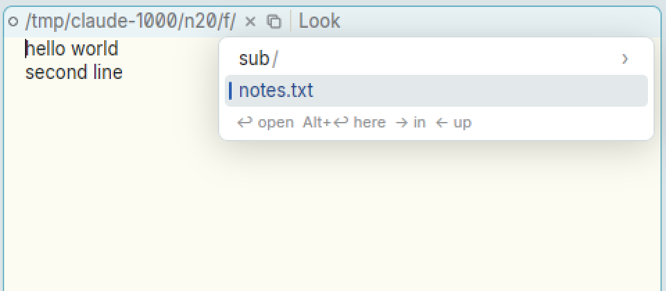
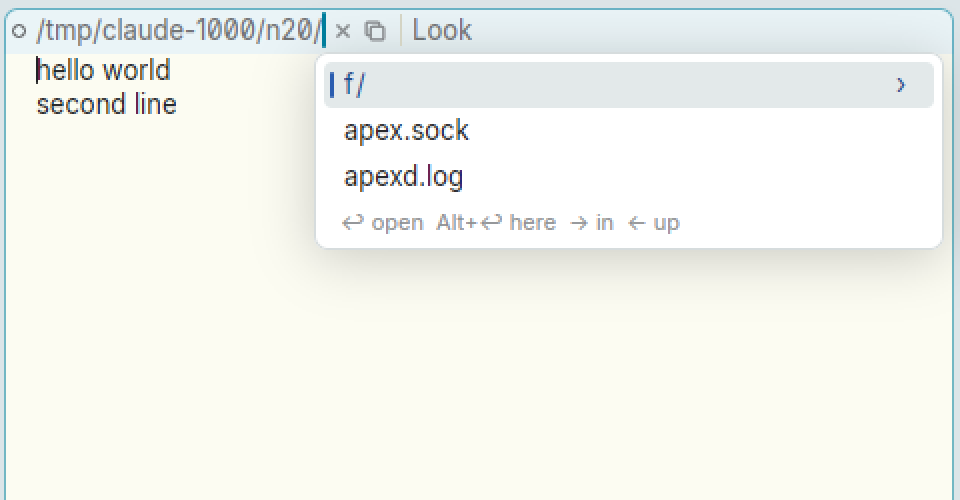
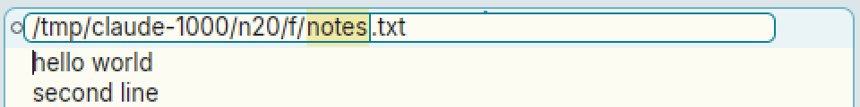
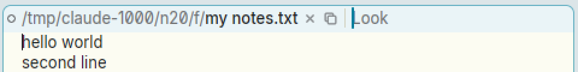
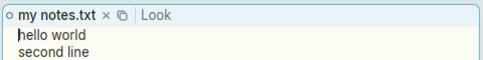
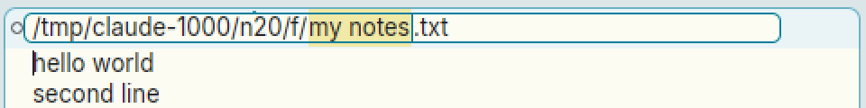
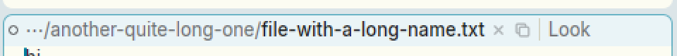
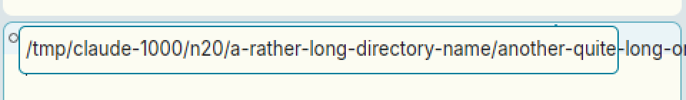
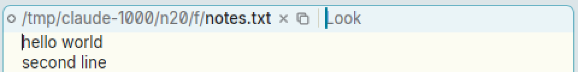

# Editing the window's name in the tag behaves unlike editing text

**Type:** bug (UX)
**Area:** tag (`tagedit.rs`, head layout)

## Summary

In acme the file name is just the first word of the tag. You edit it like any other text: click to put the caret there, type, backspace, sweep to select. In Apex the path is a separate "head" drawn before the editable tag text, and editing it works quite differently:

- A single click doesn't put a caret in the name. It removes the name from the tag and drops down a directory picker, and typing then filters the picker.
- A double-click opens a separate text field laid over the whole tag.
- The mouse does nothing inside that field.
- The field shows the absolute path even when the tag shows a relative one.
- A long path overflows the field.
- After a rename the window is still marked clean.

Taken together, editing the name doesn't feel like editing text, which is presumably what "editing filename in tag is weird" means. Two related problems have their own issues and are left out here:

- An edit is lost unless you press Return: see [02-tag-title-edit-not-persisted.md](02-tag-title-edit-not-persisted.md).
- The name can't be selected or copied: see [13-tag-filename-select-copy.md](13-tag-filename-select-copy.md).

## Steps to reproduce

Start from a fresh Apex with one window on `/tmp/x/f/notes.txt`, where the session's directory is somewhere else.

1. **Single click on the name** `notes.txt`. The name disappears from the tag, leaving `/tmp/x/f/`. A picker listing the folder drops down below it.
2. With the picker still down, press **Backspace**, as you would to delete the name's last letter. The picker goes up a directory: the tag now shows `/tmp/x/` and lists its contents. Typing `no` instead shows `/tmp/x/f/no` in the tag and filters the list. It looks like you are editing the name, but you are typing a query. Press Escape.
3. **Double-click on the name.** A bordered text field holding the path appears over the whole first row of the tag. It covers the ×, the copy icon, the divider and `Look`, and its left edge cuts through the window's dot. The stem `notes` is selected, wherever you double-clicked.
4. Inside the field, **click** somewhere else in the path, then type `Q`. `Q` goes in at the old caret position, not where you clicked. **Dragging** across the text selects nothing. Only the keyboard (arrows, ⌥/⌘ arrows, Ctrl-A/E/U/W) moves the caret or selects.
5. Type `my notes` over the selected stem and press **Return**. The window is renamed to `/tmp/x/f/my notes.txt`, and spaces work fine. But the dot stays hollow and no Put appears. The window is still marked clean, although `my notes.txt` doesn't exist on disk; only `notes.txt` does.
6. Set the session's directory to `/tmp/x/f` (`apex cd /tmp/x/f`). The tag now shows just `my notes.txt`. **Double-click** it: the field shows `/tmp/x/f/my notes.txt`, so the name you clicked jumps to the right, past text that wasn't in the tag a moment ago.
7. Open a file with a long path outside the session's directory, e.g. `/tmp/x/a-rather-long-directory-name/another-quite-long-one/file-with-a-long-name.txt`. The tag shows it shortened as `…/another-quite-long-one/file-with-a-long-name.txt`. **Double-click** the name. The field is 420px wide, but the full absolute path is wider, and the text spills out past the field's right border and the window's edge. The selected stem and the caret are off-screen, so you can't see what you are typing; End doesn't scroll it into view. The field also sits a few pixels lower than the tag row here.
8. Click in the editable part of the tag just before `Look` and press Backspace or ←. The caret stops at the divider. The keyboard can't reach the name from the tag text.

## Expected behaviour

As in acme, the name should be editable like the rest of the tag: the tag *is* text, and its first word is the name.

- B1 in the name places the caret there, and B1 sweeps select part of it.
- Typing and Backspace edit the name where the caret is. They don't filter a list, and they don't navigate to the parent folder.
- What you edit is what you see. If the tag shows `my notes.txt`, the edit starts from that text, not from an absolute path that suddenly appears. If a relative name is kept, it should be resolved against the directory that the shortened display implies.
- The edit stays inside the tag's own row and scrolls or wraps like the rest of the tag. It doesn't float over the tag's commands or run past the window's edge.
- After a name change the window counts as modified. acme's `wincommit` sets `mod`/`dirty` when the tag name changes, so `Put` appears and writes to the new name.

The breadcrumb picker is useful. But it currently takes over the gesture (a single click) and the keys (typing, Backspace) that acme users expect to edit the name. It could hang off a different gesture or a dedicated affordance instead.

## Actual behaviour

- A single click on the name removes it from the tag and opens a picker. Typing filters the picker, and Backspace with nothing typed goes up a directory (step 2).
- A double-click opens a free-floating field over the whole tag row (step 3).
- Clicking or dragging inside the field does nothing; only the keyboard edits (step 4).
- The double-click selects the stem, not the word under the pointer (step 3).
- A rename leaves the window clean, with no Put (step 5).
- The field shows the absolute path even when the tag shows a relative or shortened one (steps 6–7).
- A long path overflows the fixed-width field. The caret and selection can end up out of sight, and the field is misaligned with the tag row (step 7).
- The tag's editable text starts after the divider, so the keyboard can't reach the name (step 8).
- Clicking away or pressing Escape discards the edit; see issue 02.

## Screenshots

Single click on the name: the name vanishes and a picker drops down.

Then Backspace: instead of deleting a character, the picker goes up to the parent folder.

Double-click: a field covers the whole tag row and selects the stem.

Renamed to `my notes.txt` (with a space) with Return: the dot is still hollow and no Put appears, although the file doesn't exist.

The tag shows a relative name (the session's directory is `/tmp/claude-1000/n20/f/`) ...

... but the field opens on the absolute path:

A long path, shortened in the tag ...

... overflows the field and the window once you double-click it. The caret and selected stem are off-screen, and the field sits lower than the tag row.

The tag's own text starts after the divider; Backspace and ← stop there.

## Notes

- Reproduced on Linux, X11 (nested Xephyr), using the prebuilt `target/apex-linux/bin/apex-ui` from branch `001-linux-support`.
- This is the intended design according to MODERN.md (around line 412) and docs/userguide.html ("Double-click the path to rename the window's file"). The issue is that the design behaves unlike acme and unlike text editing generally, plus the bugs in steps 4, 5 and 7.
- Code pointers:
  - `crates/apex-client/src/tagedit.rs:168` `press_atom`: a single click opens the picker; a double-click calls `tag_edit_start`.
  - `tagedit.rs:218` `tag_edit_start` sets the field from `window_path`, which is absolute, and selects the stem.
  - `tagedit.rs:256` `tag_edit_key` handles Return and Escape only; a rename goes through `Proposal::SetPath` and nothing marks the window dirty.
  - `tagedit.rs:~540` `tag_overlays`: the field is fixed at 420px (`min_w` is the path's width + 48), and its `on_mouse_down` only does `stop_propagation`, which is why clicks inside it are ignored.
  - `app.rs:~3486`: the second click of a double-click anywhere on the tag turns the path into a field.
  - Relative and shortened display: `Head::build_in` in `crates/apex-client/src/text_element.rs`.

## Fix

Steps 1, 2 and 8 (a single click opens the folder picker and typing
filters it; the tag's keyboard can't reach the name) are the deliberate
breadcrumb design (MODERN.md, docs/userguide.html) and are unchanged. The
stem-selected-on-open of step 3 is kept too: it is what a rename most
often changes. The rest is fixed:

- **Mouse in the field (step 4).** B1 places the caret at the character
  under the pointer, a B1 sweep selects, a double-click selects a word and
  a triple-click everything. A press inside the selection keeps it until
  B1 comes up, so the B1-B2/B1-B3 chords still cut or paste over it; a
  click and then a chord pastes at the point.
- **Dirty after a rename (step 5).** `Node::set_window_path` marks a
  file's buffer changed (the replicated `marked` flag, `BufferOp::Mark`)
  whenever it renames it, as acme's `wincommit` does, so Put appears.
  That covers the field, the 1-3 chord on the path, `apex win rename` and
  tools. Renaming to the same name does nothing; Put to a new name ends
  clean (rename, then Clean).
- **Relative names (step 6).** The field opens on the path as the tag
  shows it (from the session's directory on), and a relative name
  committed is resolved in that directory. A path shortened with `⋯/`
  (not inside the session's directory) still opens in full: there is
  nothing editable behind the ellipsis.
- **Long paths (step 7).** The field is as wide as its text plus some
  room, never past the tag row's right edge; past that the text is
  clipped and scrolls to keep the caret in sight (it opens scrolled to the
  end, so the name shows). It stays level with the tag row, and nothing
  spills over the window behind.
- **Covering the tag (step 3).** As a side effect, a short path's field
  no longer covers the tag's commands (it used to be a fixed 420 px). A
  long path's field still runs to the row's end over ×, Put and Look
  while it is open.

The fix is in the commit that contains this section.
