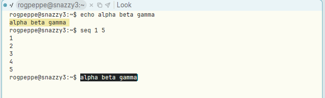
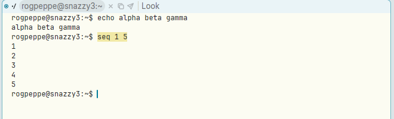
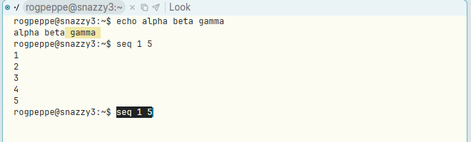

# B1-B2-B3 chord in a terminal types the selection at the prompt instead of just copying it

**Type:** bug
**Area:** terminal, mouse

## Summary

In a text window, the acme chord "sweep with B1, then click B2, then B3"
cuts the text and pastes it straight back: the net effect is a copy to
the snarf buffer, with the text unchanged. In a terminal window the same
chord copies the selection (B2) and then types the clipboard into the
shell (B3), so the swept text appears on the shell's input line. The
chord should just copy and leave the terminal's input alone.

## Steps to reproduce

1. Start Apex and open a terminal with `Newterm`.
2. Run `echo alpha beta gamma`.
3. Sweep `alpha beta gamma` on the output line with B1 and, keeping B1
   held, click B2, then click B3, then release B1.

## Expected behaviour

`alpha beta gamma` goes to the snarf buffer (and the clipboard), and
nothing goes to the shell. In acme, 1-2-3 is the idiom for copying:
the cut and paste cancel out and leave the text as it was. A `win` window
in acme behaves that way too: text pasted back above the output point is
not sent to the shell. In a terminal there is nothing to cut, so B2
already copies; the B3 that follows, in the same chord, should not type
anything into the shell.

## Actual behaviour

The text is copied, and then also typed at the shell prompt
(`rogpeppe@snazzy3:~$ alpha beta gamma`). If you press Return without
noticing, it runs as a command.

How the chords currently behave in a terminal:

- **B1-B2** (sweep, then B2): copies the selection to the snarf buffer
  and clipboard; the prompt is left alone. This is right.
- **B1-B3** (sweep, then B3): types the clipboard/snarf buffer into the
  shell (in the screenshot below, the earlier `seq 1 5` is typed at the
  prompt while `gamma` is swept). This matches `Send` and is reasonable on its own.
- **B1-B2-B3**: does both of the above in turn, so the text that was just
  copied is typed at the prompt.

## Screenshots

After B1-B2-B3 on `alpha beta gamma`: the text is typed at the prompt.

After B1-B2 on `seq 1 5`: copied, and the prompt is untouched.

After B1-B3 sweeping `gamma`: the snarf buffer (`seq 1 5`) is typed at the prompt.

## Notes

- Reproduced on Linux under X11 (nested Xephyr), with the prebuilt
  binaries from branch `001-linux-support` at afce379.
- Likely code: `chord` in `crates/apex-client/src/app.rs:3604`. In the
  `term_drag` branch, B2 calls `term_copy` and B3 calls
  `term_paste_clipboard` (`app.rs:4004`) on their own. Neither knows
  whether the other has already happened in the same chord. One fix:
  when B3 follows B2 in the same B1 hold (`mouse.chorded` is already
  set by the copy), treat it as a no-op, or make it copy too.

## Fix

`chord` in `crates/apex-client/src/app.rs` now remembers, per terminal
sweep, that B2 has copied (`Mouse::term_copied`, cleared when B1 starts
a terminal sweep). A B3 after that in the same sweep does nothing, so
1-2-3 only copies; B1-B2 and B1-B3 alone behave as before. The laptop
equivalent (⌥ then ⌘ while sweeping) follows the same rule. The commit
containing this section has the change.
