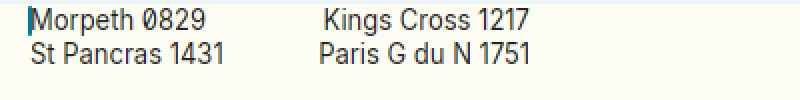
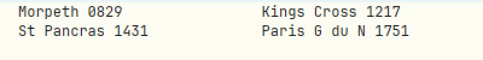
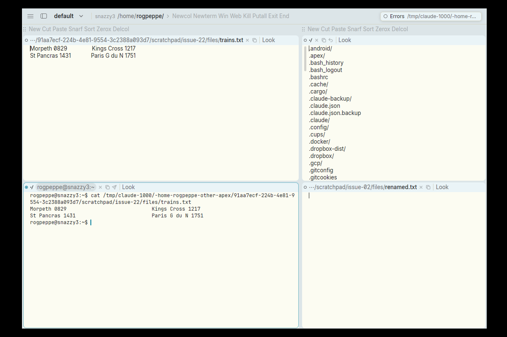

# Tab-separated columns don't line up in the proportional font

**Type:** bug
**Area:** text layout / rendering

## Summary

Apex lays out tabs by replacing each one with spaces up to the next
multiple of 4 *characters*, then draws the line in whatever font the
window uses. In a fixed-width font that works. In the default
proportional font, the text before a tab and the spaces after it have
different pixel widths, so columns that should start at the same tab
stop are drawn at different x positions. Separately, the `Tab n` command
records the new width but the window is still drawn with width 4.

## Steps to reproduce

1. Make a file with real tabs (four between the columns on each line):
   `printf "Morpeth 0829\t\t\t\tKings Cross 1217\nSt Pancras 1431\t\t\t\tParis G du N 1751\n" > trains.txt`
2. Open it in a fresh Apex window (default proportional font).
3. Compare where "Kings Cross" and "Paris" start.
4. Middle-click `Font` in the window's tag to switch to the fixed-width font, and compare again.
5. Switch back with `Font`, then run `Tab 8` and then `Tab`.
6. Open a terminal (`Newterm`) and run `cat trains.txt`.

## Expected behaviour

Both lines' second columns start at the same x. "Morpeth 0829" (12
characters) and "St Pancras 1431" (15 characters) both end inside the
same tab cell (columns 12 to 16), so four tabs take both lines to the
same stop.

In acme, a tab stop is a fixed pixel position: `tabstop` × the width of
'0' in the window's font, counted from the left margin
(frame(3) `maxtab`; libframe sets a tab's width to the distance from the
current x to the next multiple of `maxtab`). So tab-separated columns
line up in proportional fonts too, as long as no cell's text runs past
its stop. `Tab n` changes `maxtab` and the window is laid out again.

## Actual behaviour

- Proportional font: the second column is out by a few pixels. In the
  1200×800 test, "Kings Cross" starts at about x=218 and "Paris" at
  about x=215. "Morpeth 0829" becomes 12 glyphs plus 16 spaces, while
  "St Pancras 1431" becomes 15 glyphs plus 13 spaces. Each side's pixel
  width is the sum of its glyphs' advances, so the two don't come out
  equal. The error grows as the text before the tab gets longer or
  wider.
- Fixed-width font (`Font`): the columns line up, because there one
  character is one cell.
- `Tab 8`: nothing changes on screen, though a plain `Tab` afterwards
  reports `…/trains.txt: Tab 8`.
- Term window: `cat` lines up (the terminal is fixed-width with 8-column
  tabs), so this affects text windows only.

## Screenshots

Proportional font (the default). The second columns are misaligned:

The same window after `Font` (fixed-width). The columns are aligned:

The text window (top) next to a Term window running `cat` on the same
file (bottom), where it lines up:

## Notes

- Reproduced on Linux/X11 (Xephyr) with the prebuilt binaries from
  branch `001-linux-support`.
- Cause: `expand` in `crates/apex-client/src/text_element.rs:1235`
  turns each tab into `TABSTOP - col % TABSTOP` spaces by character
  column. The spaced string is then shaped as ordinary text
  (`expand(line_text, start)` at `text_element.rs:1543`). No code snaps
  a tab to a pixel stop such as `n × advance('0')` measured from the
  left margin. The stops are fixed (they are not counted from the
  previous character, and they are not elastic), but they are counted
  in characters, not pixels.
- `TABSTOP` is a constant 4 (`text_element.rs:61`). The window's
  `tabstop` field (`crates/apex-core/src/state.rs:55`, set by `Tab` in
  `crates/apex-core/src/node.rs:2266`) is never passed to the renderer.
  The miniature view does honour it
  (`crates/apex-client/src/miniature.rs:102`).
- A fix would place each tab at the next multiple of
  `tabstop × width('0')` in pixels from the line's left edge, as
  libframe does. Mapping clicks and selections back from x to text
  position would also need to know those widths.

## Fix

Text windows and tags now lay tabs out as acme's libframe does: each
tab is shaped as one space and then widened to the next tab stop, a
multiple of `tabstop` × the width of '0' in the window's font, counted
from the start of its row (a tab already on a stop goes to the next;
one that would be narrower than a space, or reach past the row's end,
is a space wide). A line with tabs is shaped unwrapped and wrapped
afterwards by `tab_layout` (gpui's wrapping rules), so each wrapped
row's tabs count from where it starts. The glyph positions themselves
are moved (`retab` in `crates/apex-client/src/text_element.rs`), so
clicks, sweeps, the caret and selections agree with what is drawn. A
body's tab stops come from its window's `tabstop` (`Tab n`), now passed
through `Source::tabstop`; tags keep 4. The fix is in the commit that
moved this file to FIXED/.
