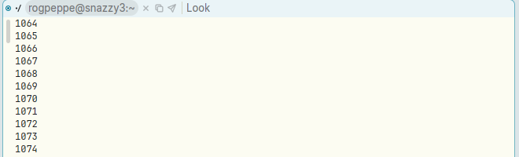
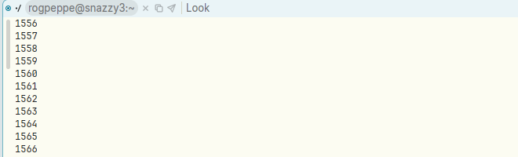

# A terminal keeps only about 1000 lines of scrollback, not Newterm.scrollback's 10000, and fewer the wider the window

**Type:** bug
**Area:** terminal (scrollback / libghostty-vt binding)

## Summary

`apex help term` says a terminal keeps `Newterm.scrollback` lines of history,
10000 by default. In practice a terminal keeps far fewer. After `seq 1 2000` in
a half-width Term window, the oldest line you can scroll back to is 1064, so
about 940 lines are kept. In a full-width window the oldest is 1556 (about 445
lines). The setting reaches Ghostty correctly as a line limit. But libghostty-vt
also has a separate scrollback *byte* limit, and its default is only 10 000
bytes. The shim never changes that default. Ghostty raises such a tiny byte
limit to the smallest it allows, which is the active area plus one spare page.
The byte limit is reached long before the line limit, so it is what decides how
much history is kept. A page holds a fixed number of cells (215×215), not a
fixed number of rows, so the wider the terminal, the fewer lines are kept.
Raising `Newterm.scrollback` changes nothing; lowering it does take effect.

## Steps to reproduce

1. Start Apex with the default two columns. In the left column, run
   `apex term new` (or click Newterm). The window is about 85 columns × 42 rows.
2. In the terminal, type `seq 1 2000`.
3. Scroll the body all the way back, with the wheel or the scroll bar.
4. Delete the right column (Delcol) so the left column fills the screen. Make a
   new terminal there (149 columns × 42 rows, as `stty size` reports), run
   `seq 1 2000` again and scroll back to the top.
5. Optionally, `apex set Newterm.scrollback 100000` and repeat with a new
   terminal: the result is the same.

## Expected behaviour

The terminal keeps `Newterm.scrollback` lines (10000 by default), give or take
Ghostty's page-sized rounding. That is what the help text and the comments on
`TermHost::spawn` and `scrollback_setting` promise. How many lines are kept
should not depend on the window's width. (acme's win(1) has no line limit at
all, because the window body holds the whole transcript. A 10 000-line cap is
fine, but it should be the cap that actually applies.)

## Actual behaviour

In the GUI (Xephyr 1200×800, Linux build, current `main`):

| window | `stty size` | oldest line after `seq 1 2000` | lines kept (history + screen) |
|---|---|---|---|
| half width | ≈85 cols × 42 | 1064 | ≈938 |
| full width | 149 × 42 | 1556 | ≈446 |

I also measured libghostty-vt directly, using a scratch program that calls
`ghostty_vt_sys::Terminal::new(cols, 42, setting)`, writes `seq 1 20000` and
reads `size()`. History rows kept:

| cols | setting 1000 | setting 10 000 | setting 100 000 |
|---|---|---|---|
| 40 | 528 | 1671 | 1671 |
| 80 | 885 | 885 | 885 |
| 120 | 609 | 609 | 609 |
| 160 | 462 | 462 | 462 |
| 215 | 212 | 212 | 212 |
| 300 | 119 | 119 | 119 |

Above about 1000 lines the setting makes no difference. The ceiling falls
roughly as 1/cols, apart from page-boundary jitter: at 215 columns and above, a
page holds only about 215 or fewer rows.

I then added one line to a copy of the shim,
`ghostty_terminal_set(vt->term, GHOSTTY_TERMINAL_OPT_SCROLLBACK_MAX_BYTES, NULL);`,
to remove the byte limit. The same probe then gave about 9 550–9 980 history
rows for a setting of 10 000 at every width, and all 19 959 rows for a setting
of 100 000. So the line setting works once the byte limit is out of the way.

## Screenshots

Top of the scrollback, half-width window (oldest line 1064):

Top of the scrollback, full-width window, 149 columns (oldest line 1556):

## Where to look

- `crates/ghostty-vt-sys/src/shim.c: apex_vt_new` sets only
  `GHOSTTY_TERMINAL_OPT_SCROLLBACK_MAX_LINES`. It never sets
  `GHOSTTY_TERMINAL_OPT_SCROLLBACK_MAX_BYTES`.
- In Ghostty (pinned commit 4ff699343ad0, checkout under
  `~/.cache/apex/ghostty-4ff699343ad0/src`):
  - `src/terminal/c/terminal.zig: new_` calls `ZigTerminal.init` with only
    `cols` and `rows`. So it gets `Terminal.Options` defaults:
    `max_scrollback_bytes: ?usize = 10_000` and `max_scrollback_lines = null`
    (`src/terminal/Terminal.zig`, `Options`).
  - `src/terminal/PageList.zig: Limits.max(.bytes)` is
    `@max(explicit, minMaxSize(cols, rows))`. `minMaxSize` is
    `PagePool.item_size * (pages to hold the active area + 1)`, so with
    10 000 bytes the effective cap is one spare page beyond the screen. `grow`
    prunes the first page when `page_size + item_size > max(.bytes)`.
  - A standard page is `std_capacity` = 215×215 cells (`src/terminal/page.zig`),
    and `initialCapacity(cols)` trades rows for columns. That is why the cap in
    lines shrinks as the window widens. `Limits.resize` recomputes the minimum
    on every resize, so the cap follows the current width, not the 80×24 the
    terminal is created at (`PendingTerm` in `crates/apex-server/src/lib.rs`).
  - `include/ghostty/vt/terminal.h` documents both options and notes that "If
    both are set, the first-reached limit is used".
- The setting's path is correct and needs no change: `scrollback_setting` /
  `DEFAULT_SCROLLBACK = 10_000` (`crates/apex-server/src/lib.rs`), then
  `Server::new_term` / `restored_term`, then `PendingTerm.scrollback`, then
  `TermHost::spawn` (`crates/apex-server/src/term.rs`), then
  `ghostty_vt_sys::Terminal::new`, then `apex_vt_new`. The daemon's restore path
  reads the setting the same way (`crates/apex-server/src/daemon.rs`, `Loader`).

Likely fix (small): in `apex_vt_new`, set
`GHOSTTY_TERMINAL_OPT_SCROLLBACK_MAX_BYTES` to NULL (no byte limit), so the line
limit is the only one. Alternatively, set it to a generous figure as a safety
net against very wide or heavily styled output. A unit test in ghostty-vt-sys
along the lines of the probe above (write 20 000 lines at 80 and 200 columns,
assert `size().0` ≥ ~9 500 for a setting of 10 000) would stop this coming back.

## Notes

- This is shared code (the libghostty-vt binding from b7c72d7), not the Linux
  work. macOS terminals run the same shim, so they will behave the same way,
  with the cap depending on their column count.
- The help text in `crates/apex-cli/src/main.rs` (`term`) is correct about the
  intended behaviour. Only the binding is wrong.
- Even with the fix, Ghostty prunes only whole pages. Its header says the line
  limit is usually exceeded "by dozens to a hundred or so lines", but I measured
  a few hundred *under* 10 000. Also, a setting below one page (e.g. 1000 at 40
  columns gives 528) is raised to at least one page. Neither matters much.

## Fix

`apex_vt_new` in `crates/ghostty-vt-sys/src/shim.c` now also sets
`GHOSTTY_TERMINAL_OPT_SCROLLBACK_MAX_BYTES` to NULL, which removes the byte
limit. The line limit from `Newterm.scrollback` is then the only one, and it
also bounds memory (about lines × cols cells). A new test in
`crates/ghostty-vt-sys/src/lib.rs`
(`the_scrollback_keeps_the_lines_it_is_asked_to_whatever_the_width`) writes
20 000 lines at 80, 200 and 400 columns, and again after halving the width.
It checks that about 10 000 lines are kept each time (9 555–9 988 measured),
and that a lower setting still holds. In the GUI, after `seq 1 20000` in a
half-width terminal the oldest line is now 10105 (it was 1064 after `seq 1 2000`).
The fix is in the commit that moved this file to FIXED/.
