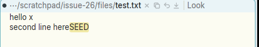

# Typing over a selection does not put the replaced text in the snarf buffer

**Type:** bug
**Area:** keyboard / text editing, snarf buffer

## Summary

In acme, any key that edits the text replaces a non-empty selection by
cutting it first, with snarf. So the replaced text lands in the snarf buffer
and a later Paste brings it back. In Apex, typing a character, Return or Tab
over a selection replaces it, but the snarf buffer and clipboard are
unchanged. Backspace, ^H, ^U and ^W behave differently again: they set the
session's internal snarf buffer but not the system clipboard. Every paste
path reads the clipboard first, so that text can't be pasted either. Delete
(forward delete) snarfs nothing. Escape was fixed separately in f3efb23
(issue 15).

## Steps to reproduce

1. `printf 'hello world\nsecond line here\n' > test.txt; apex open test.txt`
2. Put something known on the clipboard, e.g. copy `SEED` from anywhere (I
   used `echo -n SEED | xclip -selection clipboard`).
3. Double-click `world` in the body (`apex sel` gives `6 11`).
4. Type `x`. The line now reads `hello x`.
5. Paste at the end of line 2: sweep with B1 there and click B3 (or ⌘V /
   Ctrl+V, or B2 on `Paste`).

For the other keys: put `alpha beta gamma delta` in the body, select `beta`
(`apex sel WIN 6 10`), press the key, then check the text, the clipboard and
`apex events -shard=layout` (a `Snarf` entry shows when the session's snarf
buffer is set).

## Expected behaviour

Step 5 pastes `world`. In acme's `texttype` (plan9port src/cmd/acme/text.c,
quoted from memory, not checked against the source), the keys that only move
or scroll return early: the arrows, PgUp/PgDn, Home/End, ^A, ^E, and the
⌘-C/⌘-Z/⌘-Shift-Z commands. ⌘-X and ⌘-V are handled on their own. For every
other key, before anything else:

```c
if(t->q1 > t->q0){
	...
	cut(t, t, nil, TRUE, TRUE, nil, 0);   /* dosnarf TRUE, docut TRUE */
	t->eq0 = ~0;
}
```

So this applies to printable characters, Return (in bodies and tags; column
tags and the top row drop `\n` earlier), Tab, Esc, ^H/Backspace, ^U, ^W,
^F/Insert, and Kdel (0x7F, which acme then types as a character). `cut` with
dosnarf replaces the snarf buffer with the selection and, in plan9port, writes
it to the system clipboard (`acmeputsnarf`). For ^H/^U/^W the erase then runs
on top of the cut, so Backspace over a selection removes the selection *and*
the character before it. Apex's `Node::erase` already copies that part.

## Actual behaviour

Measured under Xephyr with the prebuilt `target/apex-linux/bin` (built
2026-11-08: it predates f3efb23, but nothing else in these paths has
changed since). The clipboard held `SEED` throughout, with `beta` (6–10)
selected in `alpha beta gamma delta`:

| key | text after | sel | session `Snarf` entry | clipboard |
|---|---|---|---|---|
| `x` | `alpha x gamma delta` | 7 7 | none | `SEED` |
| Return | `alpha \ngamma delta` | 7 7 | none | `SEED` |
| Tab | `alpha \tgamma delta` | 7 7 | none | `SEED` |
| Delete | `alpha gamma delta` | 6 6 | none | `SEED` |
| Backspace / ^H | `alphagamma delta` | 5 5 | `beta` | `SEED` |
| ^U | `gamma delta` | 0 0 | `beta` | `SEED` |
| ^W | `gamma delta` | 0 0 | `beta` | `SEED` |
| Esc | unchanged (old binary) | 6 10 | none | `SEED` |

The steps above give `hello x` / `second line hereSEED`. After Backspace over
a selected word, a B1-B3 paste also gives `SEED`: the snarf entry Backspace
wrote is overwritten from the clipboard before the paste. With the current
source, Esc cuts with snarf and clipboard (f3efb23). It was not measured here.

The **tag** behaves the same way. With the tag `Look foo bar`, double-clicking
`foo` and typing `z` gives `Look z bar` with no snarf. Backspace over `bar`
gives `Look z` (the space goes too), sets the session snarf to `bar`, and
leaves the clipboard alone.

The **terminal** isn't affected, as you'd expect. With `alpha` selected in a
terminal's output, typing `q` sends `q` to the shell's prompt. The highlight
stays, and neither the snarf buffer nor the clipboard changes. A terminal's
keys go to the program (`term_key`) and its selection is not editable text.

**Undo:** after selecting `world` and typing `x`, one Ctrl+Z restores
`hello world` with `world` selected. The replacement and the typed text
form one undo step, because `Node::insert` puts both in the current typing
group. As far as I remember, acme behaves the same way, with one Undo
restoring the selection, but I haven't checked that. A fix needs to keep
this (see below).

## Screenshots

After selecting `world`, typing `x`, and a B1-B3 paste at the end of line 2:
the clipboard's old `SEED` comes out, not `world`.



## Where to look

- `crates/apex-client/src/app.rs:Acme::text_key` (around line 5616) sends
  every key in bodies, tags, column tags and the top row. Printable keys
  (`key_char`), `"enter"`, `"tab"` and other control letters go through
  `Acme::type_text` (around line 5813), which calls `Node::insert`.
  `"backspace"` and ^H/^U/^W call `Node::erase`. `"delete"` calls
  `Node::delete_forward`, or types DEL in a live body. Only the `"escape"`
  arm checks `q0 < q1` and calls `Acme::cut` (f3efb23's change, around
  line 5750).
- `crates/apex-core/src/node.rs:Node::insert` (around line 1576) replaces
  `q0..q1` via `edit_op` in the typing group and never snarfs.
  `Node::delete_forward` (around 1684) is the same. `Node::erase` (around
  1637) does append `LayoutOp::Snarf` for a selection, so the session's
  `layout.snarf` gets it, but the client never writes that to the clipboard.
- `Acme::paste` (around line 5840), the `Paste` command in `Acme::execute`,
  and the B1-B3 chord (`Acme::chord` → `paste`) all read
  `cx.read_from_clipboard()` and overwrite `layout.snarf` from it. That's why
  erase's snarf is lost. (`tagedit.rs` uses `layout.snarf` only when the
  clipboard is empty.)
- `Acme::cut` / `Acme::snarf` (around 5823–5838) are the existing helpers:
  `node.snarf` plus `cx.write_to_clipboard`.

Possible fix, small: at the top of the non-movement part of `text_key`,
after the scroll, Home/End and ^A/^E cases and before the key is applied:
if `q0 < q1`, snarf the selection (`Acme::snarf`: session snarf plus
clipboard) and let `insert`/`erase`/`delete_forward` remove it as they do
now. Don't call `Acme::cut` there. `Node::cut` calls `end_typing()` and
takes a `new_group()`, so the typed character would start a second undo
group, and undo would take two steps instead of one. Erase's own
`LayoutOp::Snarf` then becomes redundant. Leave the column-tag/top-row
Return early return before this check, as acme does. ^F/Insert (completion)
returns before the key match. Whether to snarf there as acme does is a
separate call.

## Notes

- Shared code. `text_key` and `Node::insert/erase` are upstream, and the
  Linux commits 811a3d0/96ca2bf don't touch these paths. macOS will behave
  the same way.
- The tag's path field (`tagedit.rs`, the `field::Field` editor that opens on
  a click in the path) is a separate, platform-style editor. Its
  `insert`/`backspace` delete the selection without snarf, and Backspace
  there doesn't also erase the previous character. That's arguably right for
  that widget and out of scope here.
- Delete in Apex is the Mac's forward delete on purpose (DEL only in a live
  body), unlike acme's Kdel. The snarf question still applies to it.
- Some users may not like typing over a selection clobbering the clipboard,
  since the system clipboard is the snarf buffer. But it is acme's behaviour,
  and Esc now already does it.
- Related: issue 15 (FIXED/15-escape-on-selection.md, commit f3efb23), whose
  commit message notes this gap.

## Fix

`Acme::text_key` (crates/apex-client/src/app.rs) now calls `Acme::snarf`
(session snarf plus system clipboard) before each editing key: `type_text`
does it for typed characters, Return, Tab, control letters and DEL in a live
body, and the ^U/^W/^H, Backspace and Delete arms do it before
`node.erase`/`node.delete_forward`. The edit itself still deletes the
selection in the typing group, so one Undo restores the replaced text and
its selection (verified: `node.cut` would have started a new group, needing
two Undos). `Node::erase` no longer appends its own `LayoutOp::Snarf`. Esc
keeps f3efb23's cut. ^F/Insert (completion) still doesn't snarf. Terminals
are unchanged. The fix is in the commit that moved this file into FIXED/.
