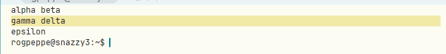

# Copying a whole-line selection in a terminal leaves off the line's final newline

**Type:** bug
**Area:** terminal, mouse, snarf

## Summary

In a terminal window a triple-click selects the whole line, and the
highlight runs on past the text to the right edge to show that the line
end is included. Copying it with B1-B2, Ctrl+Shift+C or `Snarf` gives the
text without the newline. In a text window the same triple-click
followed by a copy includes the newline. The same happens to every
terminal selection that ends at a line end: a line-wise drag over several
lines (the newlines between lines are kept, only the last one is lost) and
acme's double-click at the start of a line. Soft-wrapped rows are
already handled correctly: no newline is put where the terminal wrapped a
row.

## Steps to reproduce

1. Start Apex and open a terminal with `Newterm`.
2. Run `clear; printf "alpha beta\ngamma delta\nepsilon\n"`.
3. Triple-click on `gamma` and keep B1 down after the third click, then
   click B2 and release B1 (or release B1 and press Ctrl+Shift+C).
4. Paste somewhere, or run `xclip -o -selection clipboard | od -c`.

Multi-line and soft-wrapped:

5. Run `clear; printf "first\n"; seq -s " " 1 45; printf "last\n"` in a
   window narrower than the `seq` line, so that it wraps onto a second row.
6. Triple-click on the second (wrapped) row of the numbers and copy.
7. Triple-click on `first`, keep B1 down, drag down to `last`, then click
   B2.
8. Double-click just before the `f` of `first` (column 0) and copy.

## Expected behaviour

The copied text is what the selection covers, the line end included, as
in a body: step 3 gives `gamma delta\n`, step 6 `1 2 … 45\n`, step 7
`first\n1 2 … 45\nlast\n`, step 8 `first\n`. Where a row was soft-wrapped
there is no newline.

acme has no triple-click and no terminal, but a selection in a `win`
window is body text, so a line selected there and snarfed includes its
newline. acme's double-click at the start of a line also takes the
newline: in `textdoubleclick` (plan9port src/cmd/acme/text.c), the
`'\n'` entry of the bracket table matches forward to the next newline and
sets `*q1 = q-(c!='\n')`, which keeps the newline (quoted from memory).
Issue 18's triple-click is defined the same way, "through the next '\n'
inclusive", and the terminal highlight already shows the line end as
selected.

## Actual behaviour

Measured in nested Xephyr with a debug build of `main` at 05b3706 (the
prebuilt `target/apex-linux/bin` binaries are from 8 Nov and do not have
the triple-click from ffc3551), reading the clipboard after each copy:

| Selection | Copied | Expected |
|---|---|---|
| triple-click `gamma delta` (B1-B2, Ctrl+Shift+C alike) | `gamma delta` | `gamma delta\n` |
| triple-click on the 2nd row of the wrapped `seq` line | `1 2 … 32 33 … 45` | `… 45\n` |
| triple-click `first`, drag down to `last` | `first\n1 2 … 45\nlast` | `…last\n` |
| triple-click `alpha beta`, drag down to `epsilon` | `alpha beta\ngamma delta\nepsilon` | `…epsilon\n` |
| double-click at column 0 of `first` | `first` | `first\n` |

So the newlines between lines are kept, the wrap point is joined
correctly (`32 33`, with no newline), and only the final newline is
lost. A plain character sweep is not affected: its end is past the cell
under the pointer, so it never ends exactly at a line end. Dragging past
the end of a row gives the row's text with the trailing blanks trimmed
(`last`), as it should.

## Screenshots

Triple-click on `gamma delta`: the highlight covers the line end, but
the copy is `gamma delta` with no newline.

## Where to look

- `crates/apex-server/src/term.rs:TermHost::text` (upstream code). The
  client sends the selection as an exclusive end. A line selection ends
  at column 0 of the row after the line (`term_multi_click` /
  `term_unit_sweep` in `crates/apex-client/src/app.rs`, via
  `TermText::cell`). `TermHost::text` turns that end into an inclusive
  one on the cell before it, `(last_col, p1.1 - 1)`, and asks ghostty
  for the text from `p0` to there. ghostty's plain formatter
  (`apex_vt_text` in `crates/ghostty-vt-sys/src/shim.c`,
  `ghostty_terminal_selection_format_alloc` with `unwrap = true`) puts a
  `'\n'` between hard-ended rows and joins soft-wrapped ones, but adds
  nothing after the last row. So the newline that the exclusive end
  `(0, l)` covered is lost. The fix belongs here: when `p1.0 == 0` and
  `p1.1 > p0.1`, and row `p1.1 - 1` ends in a hard line end (not
  soft-wrapped), append `'\n'`. To tell a wrap from a hard end for rows
  in the scrollback, which the client's `wrapped` snapshot does not
  cover, either:
  - format through `(0, p1.1)` and keep the text up to and including
    the last `'\n'` (ghostty emits one only at a hard end; take care
    with a blank or wide cell at `(0, p1.1)`), or
  - have the shim report the row's wrap flag (the snapshot's
    `FLAG_WRAP`, `term.rs:213`, comes from the same row data).

  An end past the last row is clamped by `at` and needs no newline.
- Every terminal copy path goes through this function. `App::term_copy`
  (`app.rs`) is reached from the B1-B2 chord (`chord`, the `term_drag`
  branch), from Alt during a sweep (modifiers changed), from `Snarf` in
  `execute`, and from the Copy/Cut menu and Ctrl+Shift+C (`menu_edit`).
  It goes on through `term_snarf` to `ClientMsg::TermText` /
  `Server::term_text` (`crates/apex-server/src/lib.rs`), which calls
  `TermHost::text`. `term_copy_last` (⌘⇧C, the last command's output,
  `(0, a)` to `(0, b)`) loses the output's final newline in the same way
  (from reading the code, not tested). `TermHost::history` trims trailing
  newlines itself and is not affected.
- The client's own `term_grid_text` (`app.rs`, the text for B2/B3 on a
  terminal selection) already gives the newline for such an end: it
  visits the row of `(0, l)` and pushes `'\n'` before its empty slice.
  So the two extractors disagree.

## Notes

- Scope: `TermHost::text` and the shim are upstream shared code, unchanged
  by the Linux commits 811a3d0 and 96ca2bf, and there is no
  `cfg(target_os)` in the path. macOS behaves the same (high confidence,
  not tested there). Line selections in a terminal come from branch work
  (adf1034's double-click, ffc3551's triple-click and line drag), so
  upstream the bug only shows once that work is merged. The commit
  message of ffc3551 notes it ("the terminal copy of a line selection
  comes out without its final newline (the server's TermHost::text drops
  it)").
- Related: issue 18 (triple-click, FIXED), dc0fbfa (soft-wrap
  `FLAG_WRAP`, `TermLine`/`TermText`), issue 21 (terminal chords).
- A separate small bug turned up while testing. `settle_snarf` writes the
  clipboard only when the snarf buffer changes (`snarf_wanted`). Copying
  the same terminal text twice, after the clipboard has been set from
  outside Apex (by another app, or by `xclip` here), leaves the outside
  value on the clipboard: the second copy of `last` left `none` there.
  This is worth its own issue. It doesn't affect the newline results
  above, because each of those copies changed the snarf buffer.

## Fix

`TermHost::text` (now `grid_text` in `crates/apex-server/src/term.rs`)
appends the `'\n'` that ghostty's formatter leaves off when the exclusive
end is at column 0 of a later row and the row before it ended hard. The
wrap flag comes from a new shim call, `apex_vt_wrapped`
(`Terminal::wrapped` in `ghostty-vt-sys`), which reads
`GHOSTTY_ROW_DATA_WRAP` for any screen row, scrollback included, via
`ghostty_grid_ref_row`. An end past the last row gets no newline. This
covers every copy path (B1-B2, Ctrl+Shift+C, `Snarf`, the menu, and
`term_copy_last`, whose output now ends in its newline). The
`settle_snarf` side note above is a separate bug and is not fixed here.
The fix is in the commit that moved this file to FIXED/.
