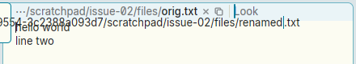
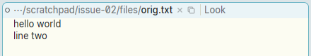
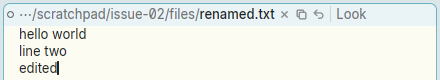

# Renaming a window in its tag is discarded unless you press Return

**Type:** bug
**Area:** tag

## Summary

Double-clicking the path in a window's tag turns it into a text field
for renaming the window. The new name only takes effect if you press
Return. If you click anywhere else instead (the body, another window),
the edit is silently thrown away and the window keeps its old name. A
later Put then writes to the old file. In acme the window name is just
the first word of the tag, so an edit there counts as soon as you make it.

## Steps to reproduce

1. Start Apex and open a file: `apex open /some/dir/orig.txt`.
2. Type something into the body so the window is dirty.
3. Double-click `orig.txt` in the window's tag. The path becomes a field,
   with the stem `orig` selected.
4. Type `renamed`. The field now reads `.../renamed.txt`.
5. Click in the window's body (or anywhere else). Do not press Return.
6. Run Put (click it in the tag, or `apex exec <win> Put`).

## Expected behaviour

After step 5 the window is called `renamed.txt`, and the Put in step 6
writes `/some/dir/renamed.txt`.

That is how acme behaves: the name is the tag text up to the first blank,
and acme reads it back whenever it needs the name (Put, Get, plumbing,
`Look`, and so on). Nothing has to be confirmed. Only Escape, or some
other explicit cancel, should throw an edit away.

## Actual behaviour

As soon as you click away, the field closes and the tag shows `orig.txt`
again. `apex win` still lists the window as `.../orig.txt`. The Put
writes `orig.txt` (the edited text ended up in `orig.txt` and no
`renamed.txt` was created). There is no sign that the rename was
dropped.

If you press Return in step 5 instead, the rename works (the tag shows
`renamed.txt` and `apex win` agrees).

## Screenshots

While editing, after typing `renamed` (the field holds the full path and
spills left over the body):

After clicking in the body without pressing Return, the old name is back:

The same edit confirmed with Return, for comparison:

## Notes

- Reproduced on Linux under X11 (Xephyr), using the prebuilt
  `target/apex-linux/bin` binaries from branch `001-linux-support`.
- The label field (double-click a window's label) goes through the same
  code, so it very likely behaves the same way. I did not test it.
- Likely code:
  - `crates/apex-client/src/tagedit.rs:256` (`tag_edit_key`): only the
    `"enter"` arm sends `Proposal::SetPath` / `SetLabel`, and
    `"escape"` cancels.
  - `crates/apex-client/src/app.rs:3383`: any mouse-down sets
    `self.tag_edit = None`. The comment there says a click "off a tag's
    field ... puts it away". This throws the edit away instead of
    committing it. `cwdbar.rs:189` and `tagedit.rs:314` (opening a
    picker) also drop it without committing.
