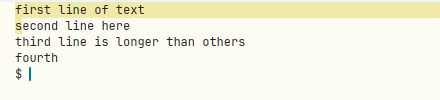
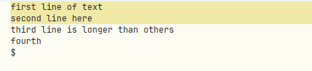
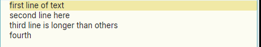

# B1 drag down in a terminal can't select whole lines: column 0 of the next row takes that row's first character

**Type:** bug; **Area:** terminal, mouse (B1 selection)

## Summary

If you sweep with B1 in a terminal window from the start of a row down to the
start of the next row, the selection holds the first row, its newline, and
the **first character of the next row**. If you drag to the end of a row
instead, you get the row without its newline. No B1 drag ends just after a
newline, so you can't select one or more whole lines. In text windows the same
drags work as they do in acme.

## Steps to reproduce

1. Start Apex and open a terminal (`Newterm`, or `apex term new`).
2. Run `printf 'first line of text\nsecond line here\nthird line is longer than others\nfourth\n'`.
3. Press B1 on the `f` of `first line of text` (column 0).
4. Drag straight down to column 0 of `second line here`, or further left into
   the window's left margin, and release.
5. Snarf (B1+B2 chord, or `Snarf` in the tag) and look at the snarf buffer
   (e.g. `xclip -o -selection clipboard | od -c`).

## Expected behaviour

As in acme (and Apex's own text windows), the end of a sweep is the character
boundary nearest the pointer. Dragging to column 0 of the next line (or
anywhere left of its first glyph) selects exactly `first line of text\n`: the
whole line with its newline and nothing from the next line. Dragging into the
blank area below the text selects through the end of the text.

## Actual behaviour

Measured results from the drags in a terminal (start at column 0 of row 1
unless stated):

| Drag ends at | Snarfed text |
|---|---|
| column 0 of row 2 (on the first glyph) | `first line of text\ns` |
| left margin of row 2 (left of the text origin) | `first line of text\ns` |
| far right of row 2 | `first line of text\nsecond line here` (no trailing `\n`) |
| far right of row 1 | `first line of text` (no `\n`) |
| blank area below the prompt | everything through the prompt (fine) |
| from column 4 of row 1 to column 4 of row 3 | `t line of text\nsecond line here\nthird`, so the cell under the pointer at the end is included |

The highlight matches. In the column 0 case the `s` of `second` shows as
selected (screenshot below).

Text windows were checked with the same text and the same drags, using
`apex sel` to read the result. All of them gave the acme result: column 0
of the next line gave `0 19` (the line plus its newline), the left margin
gave `0 19`, the blank area below gave the whole file, and a drag from the
middle of a line ended where the pointer was. Text windows are not affected.

## Screenshots

Terminal, B1 dragged from column 0 of row 1 to column 0 of row 2. The `s` of
`second` is selected too:

Terminal, dragged to the far right of row 2. Row 2 is highlighted to the edge,
but the snarfed text stops at `here` with no newline:

For comparison, a text window with the same drag (column 0 of line 1 to
column 0 of line 2) correctly selects just line 1 and its newline:

## Notes

- Linux, X11 (nested Xephyr), apex-ui from `target/apex-linux/bin` built on
  branch `001-linux-support` (afce379). Reproduced every time in terminal
  windows. Driven with xdotool, with slow and instant drags giving the same
  results.
- The user's note was "Selecting text then dragging down doesn't select whole
  line". I couldn't reproduce this in text windows, so I take it to be the
  terminal behaviour above.
- Likely code: `crates/apex-client/src/app.rs:3760-3770` (the `term_drag` case
  in mouse-move). The comment says "the end is exclusive: past the
  pointed-at cell when dragging forward", and the end is set to `c + 1`,
  where `c` comes from `TermLayout::cell_at`
  (`crates/apex-client/src/term_element.rs:26`), which truncates the pointer
  to the cell under it and clamps a left-margin x to column 0. A forward
  sweep always takes the whole cell under the pointer, so column 0 of the
  next row becomes `(1, next_row)`. Acme instead rounds the pointer to the
  nearest boundary between characters. The B2/B3 sweep (`term_sweep`, just
  above) uses the same rule and probably has the same problem.
- Side observation, not investigated: a B1 press in a terminal's left margin
  (a few pixels left of the first column) didn't seem to start a new
  selection. The previous selection stayed as it was.
- Once, in a text window, the first drag after startup left the highlight
  stopping at the end of the text instead of reaching the right edge, even
  though the selection (`0 19`) included the newline. It didn't happen again.
