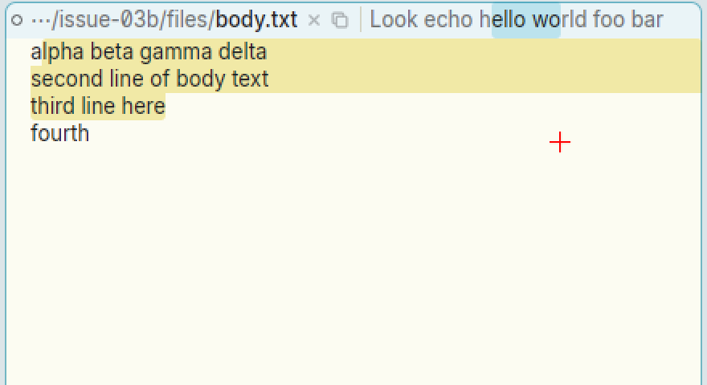
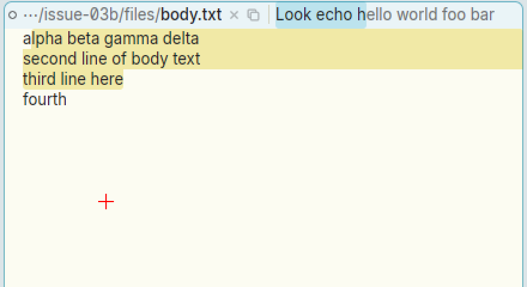
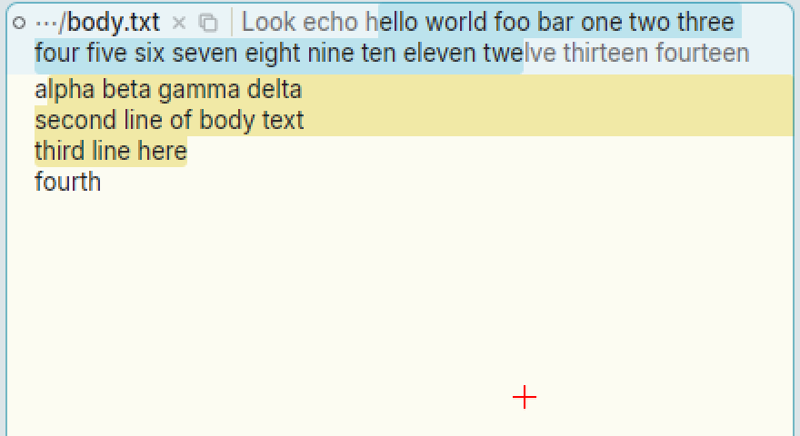
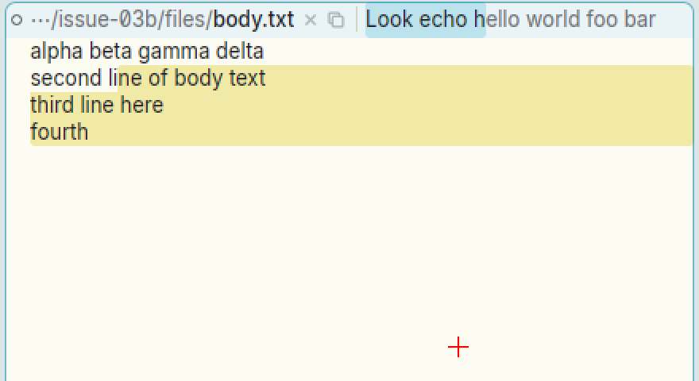

# B1 dragged below a tag stops at the pointer's column instead of the end of the tag

**Type:** bug
**Area:** tag, mouse (B1 selection)

## Summary

If you sweep with B1 in a window's tag and drag down out of it, into the
body below, the selection ends at the pointer's column on the tag's last
line. In acme, once the pointer is below the last line of the tag the
selection runs to the end of the tag text, so a sweep from partway along the
tag and a drag down takes the whole rest of the tag. In Apex you have to
drag right along the line to its end. A drag down and to the left of the
start point is worse: you get the text *before* the start point. This is
the same for a one-line tag and below the last line of a multi-line tag.
Dragging from one tag line onto the next works as it should. Window bodies
are not affected.

## Steps to reproduce

1. Open a file (`apex open /tmp/d/body.txt`) and give it some tag text, e.g.
   `apex win tag body.txt 'Look echo hello world foo bar'`. The editable tag
   text (after the name breadcrumb) reads `Look echo hello world foo bar`.
2. Press B1 just after the `h` of `hello`.
3. Without releasing, drag straight down into the window body (a few lines
   down, anywhere left of the end of the tag text) and release.
4. To see exactly what is selected, before releasing do the B1-B2-B3 chord
   (snarf) and read the clipboard (`xclip -o -selection clipboard`).
5. Repeat, dragging down and to the *left* of the start point (e.g. under the
   window's name).
6. Make the tag wrap onto two lines (a longer tag:
   `apex win tag body.txt 'Look echo hello world foo bar one two three four five six seven eight nine ten eleven twelve thirteen fourteen'`)
   and repeat step 2-3, first stopping on the second tag line, then going on
   into the body.
7. As a check, do the same in the body: start in the middle of a line and
   drag down into the empty space below the last line.

## Expected behaviour

As in acme: when the pointer is below the last line of the tag's text, the
end of the sweep is the end of the tag text, whatever the pointer's x. acme's
`frselect` (libframe/frselect.c) sets the end with `frcharofpt`, which gives
the frame's character count for any point below its last line. (The tag's
`framescroll` returns at once when the whole tag is already shown.) So:

- Step 3 selects `ello world foo bar`, the rest of the tag.
- Step 5 does the same. Below the tag, the pointer is past the end of the
  text, not before the start point.
- Step 6, stopping on the second line, selects up to the pointer there.
  Going on below that line selects through the end of the tag.

Apex's own bodies already work like this (step 7).

## Actual behaviour

What was snarfed (start just after the `h` of `hello` each time):

| Tag | Drag ends at | Selected |
|---|---|---|
| one line | in the body, below `wo` of `world` | `ello wo` |
| one line | far down in the body, same x | `ello wo` |
| one line | on the tag line itself, at `wo` | `ello wo` (same as the two above) |
| one line | in the body, left of the start (under the name) | `Look echo h` |
| one line | on the tag line, past its end | `ello world foo bar ` (what you'd want, but only by going right) |
| two lines | on line 2, at `nin` | `ello world ... eight nin` (correct) |
| two lines | in the body just below, same x | `ello world ... eight nin` |
| two lines | far down in the body | `... eleven twe` (to the pointer's column on line 2) |

The highlight while the button is held matches. Below the tag, only the x of
the pointer matters, and it is used on the tag's last line. Releasing the
button leaves the same selection. The body never gets a selection from this
gesture, and the tag doesn't scroll.

In the body (step 7) the same gesture selects through the end of the text,
as in acme (`apex sel` gave `32 71`, where 71 is the length of the file).

## Screenshots

The red cross marks where the pointer was. Each was taken with B1 still
held.

One-line tag, from `h|ello` down into the body. Only `ello wo` is selected:

One-line tag, dragged down and to the left. The text before the start point
is selected instead of the text after it:

Two-line tag, dragged well down into the body. The selection stops at the
pointer's column on the second line (`twe|lve`) instead of running on to
`fourteen`:

For comparison, the same gesture in the body selects through the end of the
text:

## Notes

- Linux, X11 (nested Xephyr), apex-ui from `target/apex-linux/bin` built on
  branch `001-linux-support` (b7dfc9b). Reproduced every time, driven with
  xdotool, with the selection read back by snarfing (B1-B2-B3) and reading
  the clipboard, since `apex sel` only reports a body's selection.
- This is probably what "Selecting text then dragging down doesn't select
  whole line" means: in a tag, dragging down doesn't take the rest of the
  line.
- Likely code: `TextLayout::offset_at`
  (`crates/apex-client/src/text_element.rs:884`). For a tag's layout
  (`padded`, set for anything that isn't a body at line 2411), it clamps the
  pointer's y into the last line, so a click on the pad under the last row
  counts as that row. The B1 drag in `mouse_move`
  (`crates/apex-client/src/app.rs`, the `self.mouse.b1` case, about line
  3775) uses the same `offset_at`, so a pointer far below the tag is treated
  as being on its last line at the same x. Unclamped, `offset_at` would
  return `text_len` below the last line, which is what bodies do and what
  acme does. A fix probably wants the clamp only for presses on the pad,
  not for the end of a drag. B2/B3 sweeps in the tag go through the same
  function and probably behave the same way.
- `mouse_move` also starts autoscrolling when a B1 drag leaves a tag's
  bounds (`autoscroll_step`, app.rs about line 4222), which picks the
  offset at the pointer's x on the tag's bottom edge. That does the same
  thing, so it would need the same change.
