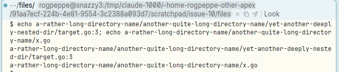
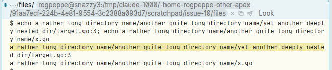
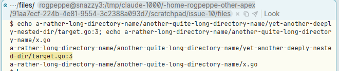
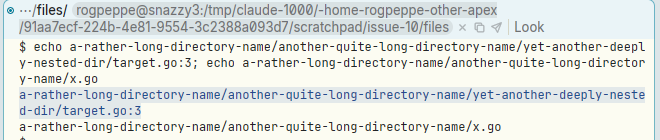
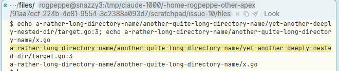

# B3 on a file name that soft-wraps in a terminal does not open the file

**Type:** bug
**Area:** terminal, mouse (B3 / look / plumb)

## Summary

In a Term window, B3 on a file name opens the file as long as the name fits on
one screen row. When the name is longer than the terminal is wide and the
terminal soft-wraps it onto two or more rows, B3 only sees the part on the row
you clicked. Nothing is opened, and the Look falls back to searching for that
fragment. Sweeping the whole wrapped name with B3 doesn't work either.

## Steps to reproduce

1. Start Apex and open a terminal (`Newterm`).
2. Make a file whose relative path is longer than the terminal is wide (about
   87 columns in a half-width column at 1200x800):
   ```sh
   mkdir -p a-rather-long-directory-name/another-quite-long-directory-name/yet-another-deeply-nested-dir
   printf 'line1\nline2\nhello\n' > a-rather-long-directory-name/another-quite-long-directory-name/yet-another-deeply-nested-dir/target.go
   printf 'x\n' > a-rather-long-directory-name/another-quite-long-directory-name/x.go
   ```
3. Print both paths:
   ```sh
   echo a-rather-long-directory-name/another-quite-long-directory-name/yet-another-deeply-nested-dir/target.go:3
   echo a-rather-long-directory-name/another-quite-long-directory-name/x.go
   ```
   The first wraps onto two rows. The second fits on one.
4. B3 on the short `.../x.go` path. A window opens on `x.go`, which is correct.
5. B3 anywhere on the first row of the wrapped `target.go:3` path.
6. B3 anywhere on its second row (`d-dir/target.go:3`).
7. B3-sweep from the start of the first row to the end of the second row.

## Expected behaviour

Steps 5, 6 and 7 should all open `.../yet-another-deeply-nested-dir/target.go`
at line 3, just as step 4 opens `x.go`. A soft-wrapped line is one line of
output, so a word that runs across the wrap is still one word. (Acme has no
terminal grid, but in acme's text windows B3's file-name expansion works on the
logical text, whatever the display wrapping. Users expect a wrapped name in a
Term window to behave the same way.)

## Actual behaviour

- Step 5: no window opens. Only the first row's fragment
  `a-rather-long-directory-name/another-quite-long-directory-name/yet-another-deeply-neste`
  is taken, and it is highlighted as a Look match.
- Step 6: no window opens. Only `d-dir/target.go:3` is taken and highlighted.
- Step 7: the sweep covers both rows while the button is held. On release no
  window opens, and only the first row's fragment is highlighted.

`apex win` lists no new window after steps 5–7. After step 4 it lists the
`x.go` window.

## Screenshots

The wrapped path (fourth and fifth rows of the body) and the short path below it:



After B3 on the first row (step 5). Only that row's fragment is highlighted and nothing opens:



After B3 on the second row (step 6). Only `d-dir/target.go:3` is highlighted:



B3 sweep across both rows, held (step 7), and the result after release:




## Notes

- Reproduced on Linux, X11 (nested Xephyr), with the prebuilt binaries from
  branch `001-linux-support` (`target/apex-linux/bin`), shell bash.
- Likely code. The client works out B3's text from one screen row at a time:
  - `crates/apex-client/src/app.rs:3890`: B3 with no sweep tries
    `term_link`, `term_url`, `term_man` and then `term_word(.., is_file_char)`.
  - `term_word_at` (`crates/apex-client/src/app.rs:4130`), `term_url` and
    `term_man` all look only at `term_layouts[w].rows[r]`. That is one row's
    text (`crates/apex-client/src/term_element.rs:232`), so a word stops at the
    row's edge.
  - A sweep goes through `term_grid_text` (`crates/apex-client/src/app.rs:4064`).
    It puts a `'\n'` between every pair of rows, so a swept wrapped name becomes
    `first-part\nsecond-part`, which doesn't name a file.
- Is soft-wrap information available? libghostty-vt has it, but it never
  reaches the client. The server's `apex_vt_text` / `Terminal::text`
  (`crates/ghostty-vt-sys/src/shim.c:487`, `opts.unwrap = true`;
  `crates/apex-server/src/term.rs:424`) already joins wrapped rows when it
  extracts text (docs/wiki/terminals.md: "Plain text between two screen
  points, wrapped lines joined"). The snapshot sent to the client, however,
  has no per-row wrap flag. `apex_core::state::Term`
  (`crates/apex-core/src/state.rs:371`) holds only `grid: Vec<Vec<Cell>>`,
  and `Cell` (`crates/apex-core/src/entry.rs:290`) has no wrap bit. So the
  client cannot tell a soft wrap from a real newline. A fix could either add a
  "row continues on the next row" flag to the snapshot (libghostty tracks
  soft wraps, since its formatter can unwrap; that it exposes a per-row flag
  through the render-state API is unchecked), or have the client ask the
  server for the logical line.
