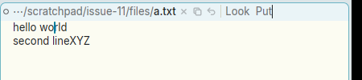
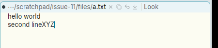

# A B1-B2 (cut) chord with a null selection does not make the window puttable, as it does in acme

**Type:** bug
**Area:** mouse (chords), tag (Put / dirty state)

## Summary

In acme, a 1-2 chord (hold button 1, click button 2) with a null selection
in a body cuts nothing but still marks the file as changed, so `Put`
appears in the tag. Acme users rely on this to Put a clean window: to
rewrite a file deleted or changed on disk, or to include it in `Putall`.
In Apex the same chord does nothing visible. The window stays clean (hollow
dot, no Put icon, no Undo icon), so there is no Put in the tag to click.

Interpretation: the note "left-middle chord with null selection doesn't
make it possible to Put window" could mean either 1-2 (cut) or 2-1 (pass
the selection to a B2 command as its argument). I tried both. The 2-1
chord on `Put` with a null selection works: the argument is dropped and the
window is written. So the note means the 1-2 chord, the acme idiom for
making Put appear.

## Steps to reproduce

1. Start Apex and open a file, e.g. `apex open /tmp/a.txt` (any file
   with some text in it). The window is clean: its tag has a hollow dot and
   no Put icon.
2. Click button 1 somewhere in the body, so the selection is null.
3. With the pointer still over the body, press button 1, press and
   release button 2, then release button 1 (a cut chord with nothing
   selected).
4. Look at the window's tag.

## Expected behaviour

As in acme, the window should be marked as changed and Put should appear
in the tag. In plan9port's acme (`src/cmd/acme/text.c`, around line 1075),
any 1-2 or 1-3 chord in a body first does

```c
if(state==None && t->what==Body){
	seq++;
	filemark(t->w->body.file);
}
```

`filemark` sets `file->seq = seq`. The tag (`wind.c:514`) shows Put when
`file->seq != w->putseq`, even if `cut` then deletes nothing. The chord
therefore makes a clean window dirty, so Put appears in its tag and
`Putall` writes it.

## Actual behaviour

Nothing changes. The tag still has the hollow "clean" dot and only the Del,
Snarf and Redo icons. There is no Put (or Undo) icon. No error is printed,
and the daemon log has nothing new.

For comparison, after typing into the window the dot fills and the Undo and
Put icons appear (second screenshot).

What does work:
- Writing `Put` in the tag and clicking it with B2 writes even a clean
  window. I checked this by deleting the file on disk and running Put: the
  file came back. ⌘S also works.
- 2-1 chord on `Put` with a null selection: `app.rs` drops an empty
  argument, so this runs a plain `Put`, which saved a dirty window. With a
  non-null selection the selection is appended as the file name, as in
  acme.

So what is missing is the acme gesture that makes Put show up in the tag
(and makes `Putall` include the window). Writing the file still works by
other means.

## Screenshots

After the null-selection B1-B2 chord, the window is still clean (hollow dot,
no Put icon). I had typed `Put` into the tag by hand for the experiments
above.



The same window after typing (dirty: filled dot, Undo and Put icons):



## Notes

- Linux, X11 (nested Xephyr), prebuilt binaries from branch
  `001-linux-support` (`target/apex-linux/bin`). Reproduced.
- Likely code:
  - `crates/apex-core/src/node.rs:1572` (`Node::cut`) does nothing to the
    buffer when `q1 == q0`. Nothing is recorded that would count as a
    change.
  - `crates/apex-core/src/buffer.rs:120` (`Buffer::dirty`) is also
    deliberately content-based. A window whose version moved on is still
    clean if its text hashes the same as the file on disk. So bumping the
    version alone would not make Put appear. Matching acme needs a
    separate "marked dirty" flag (or similar) that the chord sets and
    Put/Get clears.
  - The chord is handled in `crates/apex-client/src/app.rs:3604` (`chord`)
    and `app.rs:5542` (`cut`). The option-key form of the chord
    (`modifiers_changed`, about `app.rs:3995`) goes through the same `cut`.
