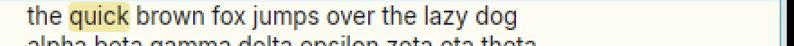
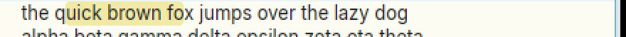
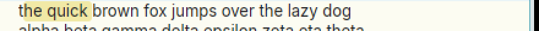
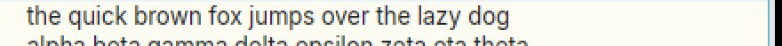

# Double-click then drag should extend the selection by whole words

**Type:** feature request (plus a small related bug)
**Area:** mouse, selection

## Summary

A double-click selects the word under the pointer, but if button 1 stays
down and the pointer moves, the word is thrown away and a plain
character-by-character sweep starts from the exact point of the click.
Most modern editors and terminals instead keep the double-clicked word as
the base and grow the selection a whole word at a time as you drag.
Apex should do the same, without losing acme's double-click matching of
brackets, quotes and lines.

## Current behaviour

To reproduce, open a file holding
`the quick brown fox jumps over the lazy dog`, then:

1. Double-click on the `u` of `quick` and keep button 1 down. `quick` is
   selected (offsets 4–9).
2. Still holding the button, drag right to the middle of `fox`. The
   selection becomes `uick brown fo` (5–18). It starts at the click point,
   not at the start of the word, and ends at the pointer's character, not
   at the end of `fox`.
3. Double-click at the start of `brown` (selects 10–15), hold, and drag left
   into `the`. The selection becomes `he quick ` (1–10). `brown` is no
   longer selected at all.
4. Related bug: double-click on `brown`, hold, and move the pointer by
   **one pixel** without leaving the character. The selection collapses to
   an empty selection at 10. The double-click is lost to ordinary hand
   jitter.

In a terminal window a double-click does not start a drag
(`mouse.term_drag` is not set), so dragging after a double-click leaves the
word as it is and doesn't extend it at all.

acme behaves almost the same way. In `textselect` (text.c), after
`textdoubleclick` it waits until the pointer moves 3 pixels, then calls
`frselect` from the original click point, so a drag after a double-click is
a character sweep in acme too. The difference is that 3-pixel dead zone,
which Apex lacks; that is why step 4 loses the word.

## Proposed behaviour

When button 1 goes down as the second click of a double-click in a text
(body or tag) window:

- Select what `node::double_click` selects now: the word, a bracketed or
  quoted span, or the line. Call it the *base* range `[b0, b1)`.
- While button 1 is held, if the pointer is at offset `p`:
  - inside `[b0, b1)`: the selection stays `[b0, b1)`;
  - after `b1`: the selection is `[b0, word_end(p))`;
  - before `b0`: the selection is `[word_start(p), b1)`.

  Here `word_start` and `word_end` take the word around `p` using
  `acme_isalnum` (the same rule as the word case of `double_click`). When
  `p` is on non-word characters (spaces, punctuation), the boundary is `p`
  itself, so you can still reach a lone `(` or `,`. That matches how
  xterm, GTK and VS Code treat the gaps between words.
- The selection never shrinks below the base, even when the base is a
  bracket, quote or line match. So you can double-click inside `(...)` and
  drag on to take in the words that follow the closing paren.
- Moving the pointer a pixel or two after the second click must not lose
  the base (fixes step 4). acme's 3-pixel dead zone would do; with
  word-wise extension, staying inside the base range already covers it.
- Chords (B1+B2 cut, B1+B3 paste) and autoscroll while dragging past the
  window edge work as they do for a normal sweep.
- Terminal windows do the same over the screen rows, using
  `term_double_click` for the base.

Triple-click and drag by lines is the same idea one level up; see
`18-triple-click-drag-by-lines.md`. That issue and this one should share
a "unit" for the drag (character, word, line). Where exactly
`double_click` picks its base next to a bracket is a separate matter,
covered by `12-double-click-before-close-paren.md`.

## Rationale

Selecting a run of whole words is common: identifiers, phrases, argument
lists. Today it takes a careful sweep that lands exactly on the first and
last characters. Double-click-and-drag by words is what people coming from
almost any other editor, browser or terminal will try first. Acme users
lose nothing: a plain single-click sweep is still character-wise. The only
change is to a double-click followed by a drag, which today throws away
the double-click's result and so is rarely done on purpose.

## Screenshots

Taken in Apex built from the branch, on the text above (scaled 2x).

1. Double-click on the `u` of `quick`, button still held. `quick` is selected:

   

2. Dragged right to `fox`. The sweep restarts at the click point (`uick brown fo`):

   

3. Double-click on `brown`, dragged left. `brown` is dropped (`he quick `):

   

4. Double-click on `brown`, pointer moved one pixel. The selection is empty:

   

## Notes

- Linux, X11 (Xephyr), prebuilt `apex-ui` from branch `001-linux-support`.
  Reproduced. The selection offsets were confirmed with `apex sel`:
  5–18, 1–10 and 10–10 for steps 2–4.
- Where the code is:
  - `crates/apex-client/src/app.rs:3532` (`mouse_down`, `Region::Text`):
    on `click_count >= 2` it selects `node::double_click(...)`, but it
    stores `Drag { view, anchor: off }`, which keeps only the click offset
    and not the base range.
  - `crates/apex-client/src/app.rs:3775` (`mouse_move`): it does
    `select(anchor.min(off), anchor.max(off))` with no notion of a unit.
    `Drag` would need the base range and a unit (char, word, line).
  - The terminal path is at `app.rs:3567`; a double-click there never sets
    `term_drag`.
  - The word rule is `apex_core::node::acme_isalnum` in
    `crates/apex-core/src/node.rs:148`.
