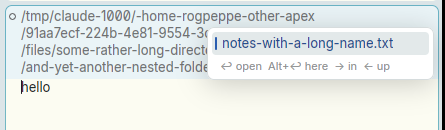
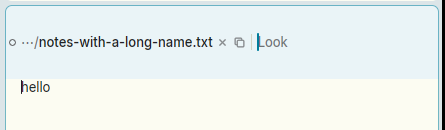
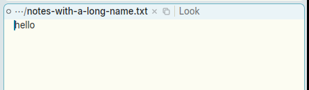

# Closing the tag's path picker leaves the tag several lines tall until something else redraws the window

**Type:** bug
**Area:** tag layout (path picker / tag height)

## Summary

When a window's path is long, its tag draws the path shortened to one line
(`…/name`). Opening the path picker with B1 on the path draws the whole folder
being listed instead. That wraps, and the tag grows to fit it, here to four
rows. Press Escape: the picker goes away and the tag's text is back to its one
shortened line, but the tag keeps its four-row height for that frame. The one
line sits in the middle of a tall empty tag, and the body is pushed down to
match. The tag shrinks only on the next redraw, and nothing asks for one. It
comes from whatever happens next: the caret's blink (up to ~0.5 s later), a
mouse move, or in my runs about 1.5 s later with View ▸ Blink Cursor off.

## Steps to reproduce

1. Make a file with a long path, e.g.
   `mkdir -p /tmp/d/some-rather-long-directory-name/another-quite-long-folder/and-yet-another-nested-folder`
   and `echo hello > .../and-yet-another-nested-folder/notes-with-a-long-name.txt`.
   The path has to be too long to fit on one row of the tag, so that it is
   drawn shortened as `…/notes-with-a-long-name.txt`. Making the column narrow
   has the same effect with a shorter path.
2. `apex open` that file. Its tag is one row: `○ …/notes-with-a-long-name.txt × ⧉ | Look`.
3. Click B1 on `…/` in the tag. The picker comes down and the tag shows the
   whole folder (`/tmp/claude-1000/…/and-yet-another-nested-folder/`), wrapped
   to four rows.
4. Without moving the mouse, press Escape.
5. To make it last, turn off View ▸ Blink Cursor first. Then the tall tag
   stays until the mouse moves or something else redraws.

## Expected behaviour

As soon as the picker is gone, the tag is laid out for the text it now shows:
one row, with the body starting right below it. In acme (from memory) a
change to the tag's text that changes how many lines it wraps to resizes the
window in the same step (`wintaglines` and `winresize` in plan9port
src/cmd/acme/wind.c). What is drawn and how tall the tag is never disagree.

## Actual behaviour

Measured under Xephyr by sampling a pixel just below where the one-row tag ends
(x=1000, y=480 on a 1200×800 screen) in screenshots taken one after another
after Escape:

- With blinking on: the first frame after Escape already shows the shortened
  one-row text, but in a tag four rows tall (the text is vertically centred in
  it). That lasted about 0.55 s, until the frame where the caret blinked off.
  Then the tag was one row.
- With View ▸ Blink Cursor off: the tall tag lasted from Escape (19:26:14.56)
  until about 19:26:16.2, so roughly 1.5 s, before an unrelated redraw fixed it.
  A mouse move at any point fixes it at once.

Opening the picker doesn't show the opposite lag (four rows of text squeezed
into a one-row tag). That is probably only because opening it happens to ask
for a second frame (see Where to look).

## Screenshots

Left: picker open, the tag four rows tall. Middle: just after Escape, the text
shortened to one row but the tag still four rows tall. Right: after the mouse
moves, the tag is one row.

## Where to look

The tag's height comes from the tiling, which reads the number of rows each
tag wrapped to in the *previous* frame:

- `crates/apex-client/src/text_element.rs`, `TextElement::prepaint`, at around
  line 1960. This is where a tag is shaped, and `shortened` chooses between the
  whole path and `…/name`. `Head::path_dirs` returns nothing while the picker's
  `Atom::Typed` is in the head, so while picking it is never shortened. The row
  count is stored with `acme.tag_need.insert(view, (wrapped - …, trailing))`.
  It runs inside `self.acme.update(cx, |acme, _cx| …)`, and nothing calls
  `notify` when the value differs from the one already there.
- `crates/apex-client/src/app.rs:Acme::measure`, called first thing in
  `render` (`crates/apex-client/src/main.rs`, around line 91). It builds
  `ClientInfo.tags` from `tag_need`, i.e. from the last frame's prepaint. Its
  `refit` pass (`tiling::taglines_rule(n, nl, …) != s.taglines` →
  `refit_window`) then sizes the slots from that stale count.
- `crates/apex-client/src/tagedit.rs:Acme::picker_key`: `"escape" =>
  self.picker = None`. The key handler's notify gives one frame. In that frame
  `measure` still sees the four-row `tag_need` from the picking head, then
  prepaint shapes the one-row shortened head and records 1. No further frame
  is requested, so the four-row slot stays on screen.

Opening the picker avoids this by accident. `main.rs`'s render calls
`picker_anchor()`, which notifies when `Atom::Typed`'s x moved from the guess
made in `open_path_picker` (it does, once the tag reflows), and
`open_path_picker` also starts a 530 ms blink loop that notifies while the
picker is up. Both stop once the picker is closed.

The general fix is probably in `prepaint`: if the new `tag_need` for a view
differs from the old one, call `cx.notify()` (the `_cx` is already there). That
gives the same "laid out next frame" pattern that `completion_anchor` and
`picker_anchor` use at the top of `render`. The `refit` check already stops
this from oscillating once the count settles. A narrower fix would notify
twice on closing the picker, but any other change to a tag's text that alters
its wrap without a second frame following (e.g. Enter in the picker, a click
off it, an external rename) would have the same lag.

## Notes

- Shared client code (`crates/apex-client`), not part of the Linux work
  (811a3d0, 96ca2bf), so macOS should behave the same. How long it lasts there
  depends on what next triggers a redraw.
- Noticed while fixing issue 13 (FIXED/13-tag-filename-select-copy.md, commit
  978645d), which uses the same picker.
- Blinking hides most of it (at most ~0.5 s). With View ▸ Blink Cursor off it
  is easy to see.
