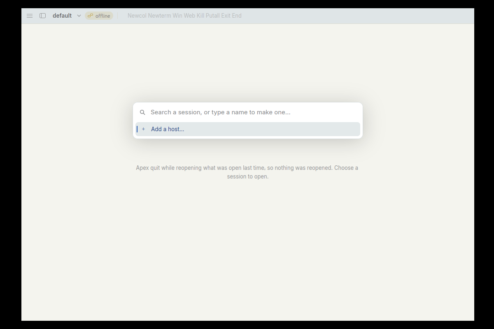
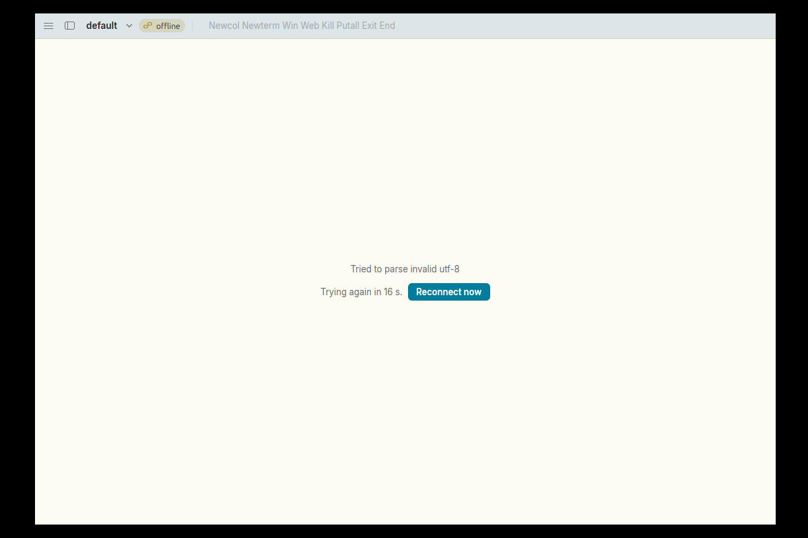

# The offline / "Apex quit while reopening…" screen redraws the whole window ten times a second

**Type:** bug
**Area:** client tick loop (waiting page / offline standing)

## Summary

When a window shows the page a tab puts up instead of acme (the
"Apex quit while reopening what was open last time…" screen, or a lost link's
"Trying again in N s. / Reconnect now"), apex-ui redraws the whole window
every 100 ms for as long as the page stays up, though nothing on it moves.
Under Xephyr, where drawing goes through Mesa's software renderer (llvmpipe),
that takes 60% of a CPU, and nearly 100% with the session picker open.
The same window idle on a session draws about one frame every three seconds
and uses about 3%. Nothing backs off: it goes on indefinitely.

The cause is the client's 100 ms tick (`Acme::over` in app.rs), which calls
`cx.notify()` whenever `acme.waiting` is set. That is for the spinner, but the
spinner is drawn only while a link is coming. On the "choose a session" page
and the offline page there is no spinner, but the notify still runs. While
a retry is pending, `link_tick` also asks for a frame on every tick, to keep
a countdown up to date that only changes once a second.

## Steps to reproduce

Isolated setup as in the issue brief (Xephyr on :77, private `HOME`,
`XDG_*`, `APEX_SOCKET`), with the current debug build (`cargo build -p
apex-client -p apex-cli`, `apex-ui`, `apex` and `rc` copied into `$W/bin`).

A. The "Apex quit while reopening" screen:

1. `$W/bin/apex-ui &`, and about 0.3 s later `kill -9` it. That leaves
   `$XDG_STATE_HOME/apex/launching` behind (`shell::launching`; it is removed
   only by `settled()`, 15 s in). Writing that file by hand does the same.
2. `$W/bin/apex-ui &` again. The window opens on `default` with an `offline`
   chip, the session picker up, and "Apex quit while reopening what was open
   last time, so nothing was reopened. Choose a session to open." under it.
3. Leave it alone, then measure CPU, e.g. from `/proc/PID/stat` utime+stime
   over 10 s, or with `top -H -b -n 2 -d 3 -p PID`.
4. Press Escape to close the picker (the page stays) and measure again.

B. A lost link that cannot come back:

1. Start apex-ui normally and leave it on a session; measure (baseline).
2. Make the daemon unable to come back, then kill the daemon (only your own
   PID). In my run I renamed `$W/bin/apex` away, so the pool started the older
   `~/.local/bin/apex` from `PATH`, and every attach failed with "Tried to
   parse invalid utf-8".
3. The page shows the error, "Trying again in 16 s." and Reconnect now.
   Measure again.

To count frames I ran apex-ui under gdb (as gdb's child, since
`ptrace_scope` is 1) with `dprintf '<apex_ui::app::Acme>::current_title',"FRAME\n"`
(`render` calls it once per frame) and `dprintf
'<apex_ui::app::Acme>::link_tick',"TICK\n"`, and counted lines per 10 s.

## Expected behaviour

A page with nothing moving on it should not be redrawn until something
changes: a key, the mouse, the pool's state, or the countdown's next whole
second. The picker's caret blink (530 ms) and, while a link is coming, the
spinner are the only things on these pages that need frames on a timer. Acme
draws only in response to events (plan9port src/cmd/acme/acme.c's main loop
blocks in `alt` on the mouse, keyboard and plumber channels; this is from
memory), so a window that is just sitting there costs nothing.

## Actual behaviour

Debug build (`opt-level` on, with debuginfo), 1200×800 Xephyr, llvmpipe:

| State | Frames / 10 s | `link_tick` / 10 s | apex-ui CPU |
|---|---|---|---|
| On a session, idle, window unfocused (no caret blink) | 3 | — | 3% |
| On a session, idle, caret blinking | — | — | 17–19% |
| "Apex quit while reopening…", picker open | 119 | 99 | 96–98% |
| Same, picker closed with Escape | 102 | — | 59–65% |
| Link lost, "Trying again in 16 s." | 99 | — | 60% |

`top -H` shows where it goes. The main thread uses about 4%. The rest is
spread over the llvmpipe render threads at about 7% each, so the time is
spent drawing frames, not in a reconnect loop. The state log
(`$XDG_STATE_HOME/apex/log`) shows no attach tries on the "choose" page. With
the lost link, it shows tries spaced by the backoff (1, 2, 5, 10, 20, 30 s),
as intended. Only the frame rate is wrong.

## Screenshots

The "choose a session" page (picker open), which redraws about 12 times a
second, and the lost-link page, which redraws 10 times a second:




## Where to look

- `crates/apex-client/src/app.rs`, `Acme::over`, the 100 ms tick loop
  (around line 1760). At line 1772:
  ```rust
  if acme.web_focus_tick(window) || acme.any_working() || acme.waiting.is_some() {
      cx.notify();
  }
  ```
  The comment says this is for "the page a tab shows while it comes up", i.e.
  the spinner. But `main.rs`'s `render` draws the spinner only when
  `actions.is_none() && !self.choosing` (the `if let Some(what) =
  self.waiting.clone()` branch, around line 269). `waiting` is still set on
  the "choose" page (`Target::Choose` → `a.choosing = true; a.wait(&why)` in
  `open_window`) and on the offline page (`wait_failed`, `reconnect`). The
  condition should be the same one that decides whether the spinner is drawn,
  roughly `waiting.is_some() && !choosing && standing(cx) == Standing::Coming`
  (that is what `waiting_actions` returning `None` means when not
  restarting). Better still, the spinner could ask for its own frames
  with `window.request_animation_frame()` in its paint closure, as
  `paint_dot`'s `spin` does (`text_element.rs`, around line 361). Then the
  tick would not need to know about it.
- `crates/apex-client/src/standing.rs`, `Acme::link_tick`, around line 256:
  ```rust
  // the countdown, said in seconds, goes on being said
  if self.retry.is_some() {
      changed = true;
  }
  ```
  This asks for a frame on every 100 ms tick while a retry is pending. It
  only needs one when `retry_said()`'s text changes (the whole second
  rounded up), so it could remember the last value it showed and compare. It
  also asks even when no countdown is drawn: `waiting_actions` (the only
  place that uses `retry_said`) returns `None` while `choosing` or
  `restarting`. On the choose page itself the tab's `why` is `"not
  attached"`, which `hopeless` treats as no retry, so this one does not fire
  there. It does fire on a lost link, where it duplicates the `waiting` notify
  above.
- `crates/apex-client/src/shell.rs`, `Acme::open_picker`, around line 1478:
  the picker's own 530 ms blink loop. That is fine in itself, and it accounts
  for the extra two frames a second with the picker open.

A fix is small: tighten the condition in the tick (or move the spinner's
frames into its paint), and make `link_tick` report a change only when the
countdown text changes.

## Notes

- Shared client code (`crates/apex-client`), not the Linux work (811a3d0,
  96ca2bf). macOS will draw the same 10 frames a second. With Metal each
  frame is much cheaper than with llvmpipe, so the CPU figure there (and on a
  Linux desktop with a GPU) will be well below 60%, but it is still constant
  work and battery drain for a window that is just waiting. The "choose" page
  after a crash, and an offline window left overnight, are exactly when
  that happens.
- Noticed while fixing issue 25 (FIXED/25-tag-tall-after-picker-escape.md,
  commit 691bf88), whose test runs killed apex-ui during startup.
- Not investigated, but seen along the way: on the "choose" page the picker
  listed no sessions, only "Add a host…", although `apex ls` on the same
  socket listed `default`.
- In setup B, with the `apex` beside apex-ui missing, the pool started
  whatever `apex` was first on `PATH` (an older build) as the daemon on the
  isolated socket. That is a side effect of how I broke the daemon on
  purpose, not part of this bug.
